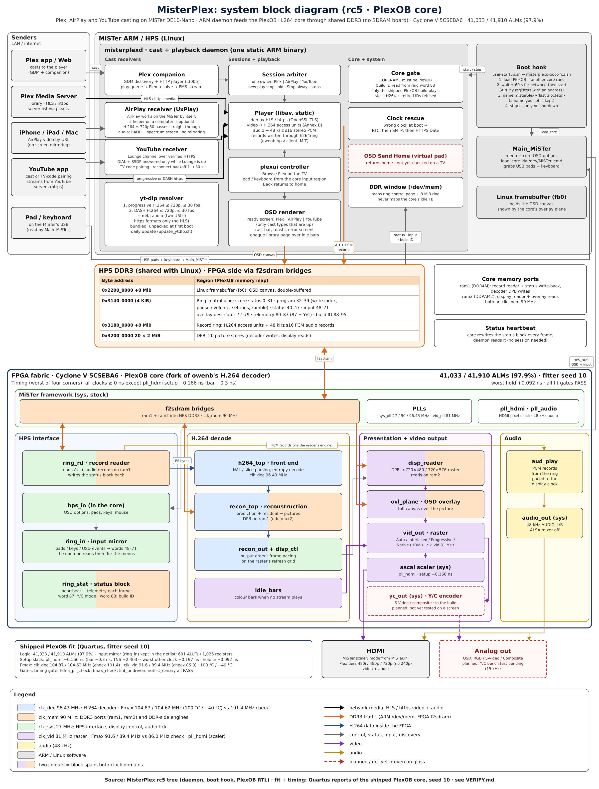

# MiSTerPlex

MiSTerPlex turns a MiSTer FPGA into a living-room media player. You can cast to it from Plex, YouTube and AirPlay, or browse your Plex library on the TV with a controller. The video is decoded in hardware by the MiSTer's FPGA and plays over HDMI, or on a CRT through the analog output.



*Your phone, or the on-screen library, tells the MiSTer what to play. The MiSTer fetches the video from your Plex server, YouTube or your Apple device. The PlexOB core on the FPGA decodes it and sends it to your TV.*

> **Current version: rc5 (a release candidate).** It's for testing, and some things are still rough. Back up your SD card before you install it.

- **Install:** [INSTALL.md](INSTALL.md)
- **Known issues:** [KNOWN-ISSUES.md](KNOWN-ISSUES.md)
- **Download:** the [Releases page](https://github.com/flynnsbit/misterplex-cast/releases) has the ready-to-install package and the source for the GPL helper programs.
- **Full user guide:** [packaging/rc3/README.md](packaging/rc3/README.md). `scripts/package_release.sh` copies it into the package as `README.md`.
- **How it is built:** [docs/architecture.md](docs/architecture.md)

---

## What it does

**Cast from Plex.** Open the Plex app on a phone or tablet, or Plex Web in a browser, and pick your MiSTer as the player. Play, pause, seek, skip and stop all work from the app. When you cast an episode, the next one in the queue plays on its own.

**Cast from YouTube.** Tap the cast button in the YouTube app and pick your MiSTer. Videos play at up to 720p. Play, pause and seek work from your phone, and stop usually does (see [KNOWN-ISSUES.md](KNOWN-ISSUES.md): the first stop after a cold boot can be lost). The MiSTer looks up YouTube videos by itself, so you don't need a computer running alongside it.

**Cast with AirPlay.** The MiSTer shows up as an AirPlay receiver on iPhones, iPads and Macs. AirPlay works on the MiSTer by itself; a helper on a computer is optional. Video that is already H.264 at up to 720p and 30 frames per second plays at full speed, because the MiSTer passes it straight through without re-encoding it. When a web stream offers several qualities, the MiSTer picks the best one it can play directly. AirPlay music plays with a simple music screen. Screen mirroring and protected (DRM) video are not supported.

**Browse Plex on the TV.** With a controller or keyboard you can open a simple library list on screen, pick a movie or show, and play it without your phone.

**Watch at up to 720p.** The PlexOB core decodes H.264 video in hardware at up to 1280x720 and 30 frames per second. Over HDMI you get a sharp picture at the video's own size. On a CRT you can use 480i or 480p.

**Let Plex do the converting.** If a video won't play directly on the MiSTer (HEVC/H.265, 1080p or 4K, 60 fps, 10-bit, or surround sound), MiSTerPlex asks your Plex server to convert it. It asks for a lower bitrate from servers outside your home, and steps down by itself if the server can't keep up. Nothing needs to be installed on your Plex server.

**Plug in and go.** After a reboot, MiSTerPlex loads its core and starts by itself. You land on a ready screen that shows the MiSTer's name and which kinds of casting are on (Plex, AirPlay, YouTube).

**Names itself.** If you don't give it a name, the MiSTer names itself after its network address and keeps that name across reboots. A name you set yourself is never changed.

**Keeps the clock right.** YouTube and secure websites need the correct date. If the MiSTer boots with the wrong time, MiSTerPlex sets it from a real-time clock if you have one, or asks the internet.

**Analog S-Video and composite (untested).** The core includes S-Video and composite output, but they haven't been tried on a real TV yet.

**Not in this release:** 240p output, subtitles, picking audio and subtitle tracks from your phone, and a nicer library browser with artwork.

## What's new in rc5

- **AirPlay video plays at full speed.** Video that is already H.264 at up to 720p and 30 frames per second is passed straight through instead of being re-encoded on the card. It plays at about 30 frames per second, where rc4 managed 2 to 3, and the processor is no longer maxed out.
- **AirPlay picks the right quality from a web stream,** and streams that redirect to another address still play.
- **AirPlay audio no longer drops sound,** and the music screen uses less of the processor.
- **The last video frame no longer stays up for the whole song** after an AirPlay video.
- **Stopping YouTube from the phone should work more often.** The YouTube connection reconnects by itself when it goes quiet, so the phone's stop usually gets through. In testing the stop arrived 3 times out of 3, but the first stop after a cold boot can still be lost (see [KNOWN-ISSUES.md](KNOWN-ISSUES.md)). If that happens, stop again or stop from Plex.

## What you need

- A MiSTer (DE10-Nano) on your home network. No SDRAM board is needed.
- SSH access to the MiSTer and a computer with `ssh` and `scp`.
- About 200 MB free on the SD card.
- For Plex: a Plex account and a Plex Media Server you can play from (your own, or one shared with you).
- For YouTube: the YouTube app on a phone or tablet on the same network, and internet access for the MiSTer.
- For AirPlay: an iPhone, iPad or Mac on the same network.

The steps are in [INSTALL.md](INSTALL.md). The most important rule: **if you already have a settings file (`/media/fat/linux/misterplex.conf`), keep it.** Never copy the example settings file over it.

At boot, the MiSTer's `user-startup.sh` runs this one line, which the installer adds for you:

```
/media/fat/misterplex/bin/misterplexd-boot-rc3.sh "$1" &
```

The file is still named `-rc3` so that cards that already boot with it keep working.

## Building from source

This repository holds the source for the MiSTerPlex program (`arm/`, `host/`), the PlexOB and Plex FPGA cores (`fpga/`), the boot scripts (`scripts/`), the cast helpers (`tools/gcast/`), the tests (`tests/`) and the packaging (`packaging/`, `scripts/package_release.sh`). Building the ARM program needs an ARM GNU toolchain; building the cores needs Intel Quartus. Most people should install the ready-made package from the Releases page instead.

The on-card AirPlay helper (`linux/gcast/ffmpeg` and `ffprobe` in the package) is built from FFmpeg, x264 and OpenSSL with `scripts/build_arm_airplay.sh` and `scripts/build_gcast_ffmpeg.sh`. The exact upstream source tarballs are attached to each release.

## Source and license

Copyright (C) 2026 FlynnsBit LLC and contributors.

MiSTerPlex is free software under the GNU General Public License, version 3 or (at your option) any later version (SPDX: `GPL-3.0-or-later`). The full text is in [LICENSE](LICENSE). The PlexOB core is a GPL-3.0-or-later fork of owenb321's MiSTer_h264_decoder, and the Plex core is built on the GPL MiSTer framework. Code from the projects below keeps its own license; all are compatible with GPLv3. Full license texts, versions and source links are in [packaging/licenses/](packaging/licenses/) and in the `licenses/` folder of the release package.

Questions and bug reports: please open an issue on this repository.

---

## Thanks

MiSTerPlex is built on the work of these projects. Thank you to everyone who made them.

| Project | What it gives MiSTerPlex | License |
|---|---|---|
| [MiSTer FPGA (MiSTer-devel)](https://github.com/MiSTer-devel): [Main_MiSTer](https://github.com/MiSTer-devel/Main_MiSTer) and the [core template](https://github.com/MiSTer-devel/Template_MiSTer) | The MiSTer platform, its menu and core loading, and the framework the PlexOB and Plex cores are built on | GPL-2.0-or-later (core framework), GPL-3.0 (Main_MiSTer) |
| [MiSTer_h264_decoder by owenb321](https://github.com/owenb321/MiSTer_h264_decoder) | The hardware H.264 decoder that PlexOB is forked from, and the ring client the program uses to feed it | GPL-3.0-or-later, client MIT |
| [UxPlay by FDH2](https://github.com/FDH2/UxPlay) | The AirPlay receiver library | LGPL-2.1-or-later, parts GPL-3.0 |
| [RPiPlay](https://github.com/FD-/RPiPlay) | The AirPlay crypto code UxPlay inherits | GPL-3.0-or-later |
| playfair (via UxPlay) | The AirPlay FairPlay handshake | GPL-3.0 |
| [csrp by Tom Cocagne](https://github.com/cocagne/csrp) | SRP pairing for AirPlay (via UxPlay) | MIT |
| [llhttp](https://github.com/nodejs/llhttp) | HTTP parsing for AirPlay (via UxPlay) | MIT |
| mdnsd (via UxPlay) | Network discovery, so Apple devices can find the MiSTer | LGPL-2.1-or-later |
| [libplist (libimobiledevice)](https://github.com/libimobiledevice/libplist) | Apple property-list support for AirPlay | LGPL-2.1-or-later |
| [FFmpeg](https://ffmpeg.org/) | Opening streams in the program (LGPL libav), and the on-card helper: `linux/gcast/ffmpeg` (GPL-3.0-or-later, with libx264) and `linux/gcast/ffprobe` (LGPL-2.1-or-later with OpenSSL) | LGPL-2.1-or-later; helper ffmpeg GPL-3.0-or-later |
| [x264](https://code.videolan.org/videolan/x264) | The video encoder in the on-card AirPlay helper ffmpeg | GPL-2.0-or-later |
| [OpenSSL](https://github.com/openssl/openssl) | Secure (HTTPS and TLS) connections | Apache-2.0 |
| [yt-dlp](https://github.com/yt-dlp/yt-dlp) | Finding YouTube video streams | Unlicense |
| [Python](https://www.python.org/) and [PyInstaller](https://pyinstaller.org/) | The Python runtime packed inside the yt-dlp release for the MiSTer, and the Python cast helpers | PSF License; GPL-2.0 with bootloader exception |
| [stb by Sean Barrett](https://github.com/nothings/stb) | Image loading, resizing and font drawing for the Plex menus | Public domain |
| [QOI by Dominic Szablewski](https://github.com/phoboslab/qoi) | A fast image format for cached menu artwork | MIT |
| [Roboto by Google](https://github.com/googlefonts/roboto) | The font on the Plex menus (`host/libmisterplex/plexui/third_party/`) | Apache-2.0 |
| [Spleen by Frederic Cambus](https://github.com/fcambus/spleen) | The 8×16 font on the library and error screens | BSD-2-Clause |
| [Mozilla CA bundle, via curl](https://curl.se/docs/caextract.html) | The list of trusted certificates for secure connections | MPL-2.0 |
| [curl](https://curl.se/) | Talking to Plex servers (the copy that comes with the MiSTer's Linux) | curl license (MIT-style) |
| [GNU C Library](https://www.gnu.org/software/libc/) and [GCC](https://gcc.gnu.org/) runtime | The C and C++ runtime | LGPL-2.1-or-later; GPL-3.0 with the runtime exception |

The test picture `tests/fixtures/glass_baseline/b6_play_sample_mjpeg720.jpg` is a frame from *Big Buck Bunny*, (c) copyright 2008, Blender Foundation, www.bigbuckbunny.org, used under the [Creative Commons Attribution 3.0](https://creativecommons.org/licenses/by/3.0/) license.

More third-party notices are in [THIRD_PARTY.md](THIRD_PARTY.md).

### Trademarks

Plex is a trademark of Plex, Inc. AirPlay, iPhone, iPad and Mac are trademarks of Apple Inc. YouTube is a trademark of Google LLC. MiSTer is the name of the MiSTer FPGA project. MiSTerPlex is an independent project and isn't affiliated with or endorsed by Plex, Apple, Google or the MiSTer FPGA project.
