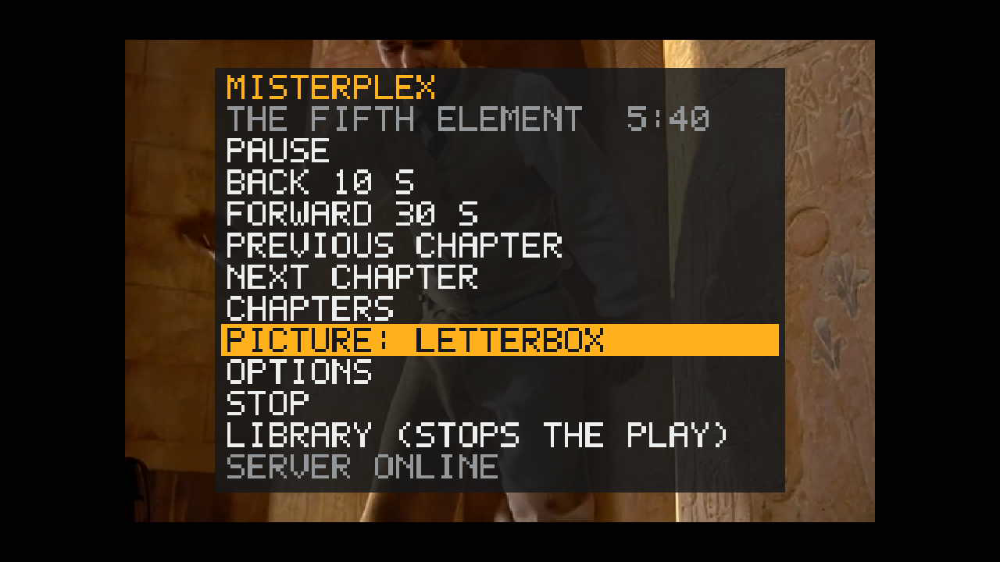
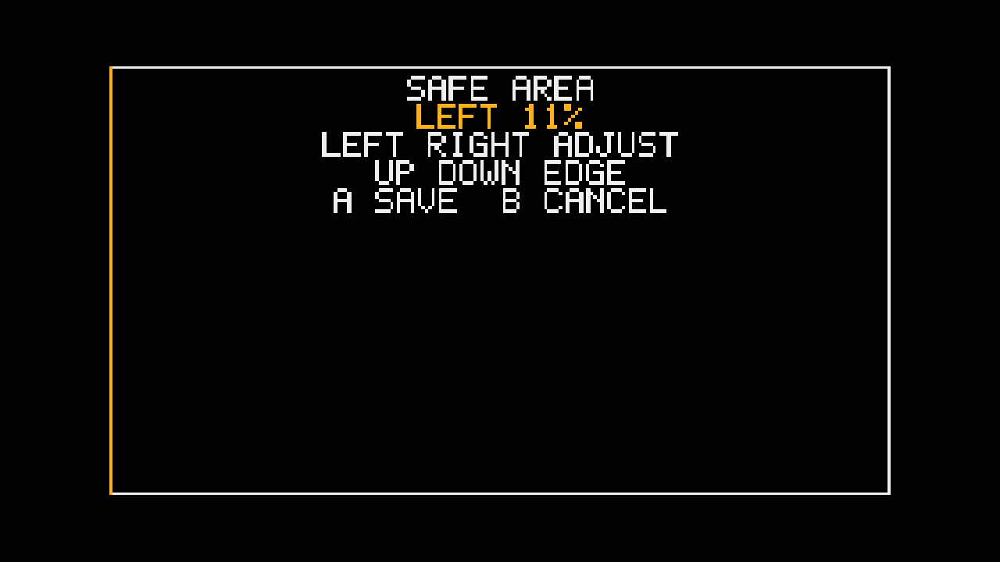

# MiSTerPlex

**Watch your Plex library, and cast YouTube and AirPlay video, on a MiSTer FPGA, on a CRT or an HDMI TV.**

MiSTerPlex turns a MiSTer (DE10-Nano) into a Plex player. A custom FPGA core, **MiSTerPlex** (`MiSTerPlex.rbf`, built from the PlexOB fork of MiSTer_h264_decoder), decodes the video in hardware. A small program on the MiSTer's Linux side, **misterplexd**, talks to Plex, YouTube and AirPlay.

The core file used to be called `PlexOB.rbf`; from rc3 it is `MiSTerPlex.rbf`, loaded from `_Utility`. To install or update, see **[Quick start](#quick-start-v101)** below and the **[install guide](docs/INSTALL.md)**.

> This is pre-release software. Things may break. Keep backups of your SD card.

## What it does

- **Cast from the Plex app.** On your phone or computer, tap the cast button and pick **MiSTer**. Play, pause, seek and stop from your phone.
- **Browse Plex on the TV.** Use a controller or keyboard with the on-screen Plex browser: home rows, Continue Watching, libraries, and a detail page for each title.
- **Cast YouTube** from the YouTube app to the MiSTer.
- **AirPlay** video from an iPhone, iPad or Mac.
- **Made for CRTs.** 480i and 240p analog output, a CRT-safe menu area, per-TV overscan trim, 4:3 / 14:9 / letterbox picture modes, and a Large menu size. S-video/composite works when `vga_mode` in `MiSTer.ini` and the core's **Analog Output** menu agree (see [Troubleshooting](docs/INSTALL.md#troubleshooting)).
- **Subtitles.** Text subtitles (SRT, ASS) drawn on screen, with an optional OpenSubtitles fallback.
- **Phone status page** at `http://<mister-ip>:3005/misterplex/status`.
- **Restarts itself** if the program crashes (needs the restart supervisor; see [What is in the v1.0.2 package](#what-is-in-the-v102-package)).

### Limits

- Video up to **720p at 30 fps, 8-bit H.264**. Anything else is converted by your Plex server, or refused for AirPlay.
- Picture-based subtitles (PGS/VobSub) need the server to burn them in, which is off by default.
- Home network only. **Never forward ports 3005, 8008 or 7000 to the internet.**

## Screenshots

Live HDMI captures from a test MiSTer:

| Plex library browser | Playback picture controls | CRT-safe screen area |
| --- | --- | --- |
| [](docs/screenshots/hdmi/plex-browser-library.png) | [](docs/screenshots/hdmi/in-play-picture-menu.png) | [](docs/screenshots/hdmi/screen-safe-area-setting.png) |

See the **[full screenshot gallery](docs/SCREENSHOTS.md)** for widescreen and 4:3 playback, picture modes, title details, and settings. Analog captures were unavailable during this session; the gallery records the missing views.

## What you need

- A MiSTer FPGA (DE10-Nano) with a current MiSTer menu, on your home network (wired is best).
- SSH access to the MiSTer (user `root`).
- A Plex Media Server and a Plex account.
- A computer with `ssh` and `scp`.
- A TV: an analog CRT (through a MiSTer analog board or adapter) or HDMI.

## How the install works

A release has **one FPGA core**, `MiSTerPlex.rbf`, which goes in `/media/fat/_Utility/` only. There is no separate `Plex.rbf` or `PlexOB.rbf` to install any more. It also has the **misterplexd** program in `/media/fat/misterplex/bin/`, which starts by itself at boot from one line in `/media/fat/linux/user-startup.sh` that runs `misterplexd-boot-rc3.sh`. After a reboot that script loads MiSTerPlex by itself (the MiSTer comes up on its menu, and the script loads the core from there), then starts misterplexd. You never need to start the program yourself. If you open another core later, load **MiSTerPlex** from `_Utility` to come back.

When `misterplexd_supervise.sh` is installed, the boot script runs misterplexd under it, and it restarts the program if it crashes (`BOOT_SUPERVISE=0` in the settings file turns that off). The v1.0.2 package, like v1.0.1, does not include the supervisor; an install that already has it keeps it.

## What is in the v1.0.2 package

The v1.0.2 download, `misterplex-<build>.tar.gz` (`<build>` is the build id shown on the release page), is the **minimal package**: the core, the program and its boot scripts, plus the installer `install-misterplex.sh`, `README.txt` and `MD5SUMS`. Every MiSTerPlex package uses the same installer name, `install-misterplex.sh`.

| File | Goes to |
| --- | --- |
| `MiSTerPlex.rbf` | `/media/fat/_Utility/MiSTerPlex.rbf` |
| `misterplexd` | `/media/fat/misterplex/bin/misterplexd` and `/media/fat/misterplex/bin/misterplexd-spelunkr` |
| `owenb_idle_card` | `/media/fat/misterplex/bin/` |
| `misterplexd-boot-rc3.sh` | `/media/fat/misterplex/bin/` |
| `misterplex_mode.sh` | `/media/fat/misterplex/bin/` |

It does **not** include the settings example, `configure-misterplex.sh`, `uninstall-misterplex.sh`, `update_ytdlp.sh`, the restart supervisor, the AirPlay helper and its ffmpeg, yt-dlp, the CA bundle or the menu fonts. An existing MiSTerPlex install keeps the copies it already has, so v1.0.2 is a complete **update**. On a card that never had MiSTerPlex, v1.0.2 installs the core and the program; AirPlay, YouTube and automatic restart need the files above, which come with the full package (not published for v1.0.2).

The release's own checksums (`MD5SUMS`, `SHA256SUMS`) are on the release page. The core md5 for each release is on its release page (v1.0.1: `042f86171b562a61694da46860b89d89`).

## Quick start (v1.0.2)

1. Download `misterplex-<build>.tar.gz` and `MD5SUMS` from https://github.com/flynnsbit/misterplex-cast/releases/tag/v1.0.2, check it, and unpack it:

   ```sh
   grep ' misterplex-<build>.tar.gz$' MD5SUMS | md5sum -c -
   tar xzf misterplex-<build>.tar.gz
   ```

2. Copy the folder to `/tmp` on the MiSTer (nothing is left on the SD card) and run the installer there:

   ```sh
   scp -r misterplex-<build> root@<mister-ip>:/tmp/
   ssh root@<mister-ip> 'cd /tmp/misterplex-<build> && sh install-misterplex.sh'
   ```

   `install-misterplex.sh` checks every file against `MD5SUMS` first (a mismatch installs nothing). Then it:
   - copies the core to `/media/fat/_Utility/MiSTerPlex.rbf` and the program and scripts to `/media/fat/misterplex/bin/`, skipping files that are already the same;
   - moves an old core at `/media/fat/MiSTerPlex.rbf` (left by an older installer; the boot script would load it first) into the backup folder, when it differs from the new core;
   - turns on start at boot: it adds this line to `/media/fat/linux/user-startup.sh` once (never twice), and keeps a copy of the old file as `user-startup.sh.bak.<stamp>`:

     ```sh
     /media/fat/misterplex/bin/misterplexd-boot-rc3.sh "$1" &
     ```

   - saves every file it replaces to `/media/fat/misterplex/backup-<time>/` and writes a `restore.sh` there that undoes this install. Old `PlexOB.rbf` files are saved there on every run (about 4 MB each), so with those on the card a re-run makes a new backup folder; otherwise, when nothing changes, it makes no backup folder. You can delete old `backup-<time>` folders you no longer need.

   It never changes an existing settings file, and it does not stop a running MiSTerPlex. `sh install-misterplex.sh --dry-run` shows what it would do without changing anything.

3. Reboot (`ssh root@<mister-ip> reboot`). MiSTerPlex loads by itself. The first time, link it at `plex.tv/link` with the code shown on the TV ([install guide, section 4](docs/INSTALL.md#4-first-start-and-link-to-plex-required)).

**If the installer can't** finish a step, it stops with `FAILED at step: …` and prints the `sh …/backup-<time>/restore.sh` command that undoes everything it changed so far. Run that and reboot, or fix the cause and run the installer again. Only if it keeps failing, do the two setup steps by hand: `sh /media/fat/misterplex/bin/misterplexd-boot-rc3.sh install` adds the boot line, and `mv /media/fat/MiSTerPlex.rbf /media/fat/misterplex/backup-<time>/` moves the old root core. An old `PlexOB.rbf` from before the rename is usually left where it is (the boot script prefers `_Utility/MiSTerPlex.rbf` unless your settings file sets `PLEX_RBF`, and you can delete it). If an earlier full install left `misterplex/cores/MiSTerPlex.rbf.md5`, the boot step may remove old `PlexOB.rbf` files; the installer saves them first and `restore.sh` puts them back.

To undo the install, run `sh /media/fat/misterplex/backup-<time>/restore.sh` and reboot. To stop and start MiSTerPlex, use the boot script: `misterplexd-boot-rc3.sh stop`, `start`, or `uninstall` (stops it and removes the boot line).

On an install that already has them, `sh /media/fat/misterplex/bin/uninstall-misterplex.sh` removes MiSTerPlex and `/media/fat/misterplex/bin/update_ytdlp.sh` updates YouTube support. `update_ytdlp.sh` checks a network download against upstream `SHA2-256SUMS` from the same GitHub origin (corruption only; no signature). A `YTDLP_LOCAL_ZIP` is checked only when `YTDLP_LOCAL_SUMS` or a pin is set. Optional pins: `YTDLP_PIN_VERSION` (release tag instead of latest) and `YTDLP_PIN_SHA256` (exact 64-hex of the zip; a mismatch refuses the install). Set both: a SHA pin alone still follows latest, so it refuses every new upstream release until you bump it.

## Settings

All settings live in one file: **`/media/fat/linux/misterplex.conf`**. No installer replaces an existing one. The v1.0.2 package does not create it: on a new card MiSTerPlex runs with built-in defaults until you add one. To start from the example, download [`assets/misterplex.conf.example`](https://raw.githubusercontent.com/flynnsbit/misterplex-cast/v1.0.2/assets/misterplex.conf.example) and copy it to the MiSTer only if it has no settings file yet:

```sh
ssh root@<mister-ip> test -e /media/fat/linux/misterplex.conf \
  || scp misterplex.conf.example root@<mister-ip>:/media/fat/linux/misterplex.conf
```

Each setting is explained inside the file. Reboot after a change.

## Optional features

These are **off by default**. Turn one on by adding a line such as `CHAPTERS=1` to the settings file.

| Area | Setting | What it does |
| --- | --- | --- |
| Browsing | `GRID_PAGE` | Library grids load past 200 titles |
| | `AZ_JUMP` | Jump to titles by first letter |
| | `FILTER_4_3` | Hide widescreen titles on library grids |
| | `WATCHED_BADGES` | Check mark on watched posters |
| | `MARK_WATCHED` | Mark watched / unwatched, remove from Continue Watching |
| | `AMBIENT` | Library art behind the idle screen |
| Playback | `CHAPTERS` | Chapter list and skip in the program menu |
| | `MARKERS` | Skip Intro, Skip Credits, Up Next |
| | `SCRUB_THUMBS` | Preview picture while seeking |
| | `IN_PLAY_OPTIONS` | Options page and Play from start during playback |
| | `PAUSE_DIM` | Dim menus while paused or idle |
| | `ALLOW_480P60` | Play 480p 60 fps video directly |
| | `REMOTE_H264_TRANSCODE` | Ask remote servers for H.264 the MiSTer can play |
| Subtitles and audio | `SETSTREAMS` | Pick subtitles and audio during playback |
| | `SOFT_SUBS` | Subtitles built into the video file |
| | `FORCED_SUBS` | Pick a forced subtitle track on its own |
| | `REMEMBER_TRACKS` | Remember subtitle and audio picks per show |
| | `track_pref_server_sync` | Also PUT the pick to `/library/parts/{id}` on the Plex server (off by default; writes to the server; use on your own server only) |
| | `BURN_SUBS_FIX` | Ask **your own** server to burn in picture subtitles |
| YouTube | `YT_CAPTIONS`, `YT_CAST_TITLE`, `YT_VOLUME`, `YT_NEXT_PREV`, `YT_LIVE` | Captions, title, volume, next/previous, livestreams |
| Display | `CRT_LOOK` | Scanline looks for menus over HDMI |
| | `REMEMBER_PICTURE` | Remember the picture mode per show. The Program menu Picture row (letterbox / 14:9 / zoom / stretch / fit-crop) applies on the shared scaler for AirPlay, mirroring, Plex, YouTube, and Spelunkr |
| Other | `ZAPAROO` | Play a Plex title from a Zaparoo card |
| | `REPORT_CODE` | Save a log bundle (private details removed) for bug reports |
| | `IDLE_MENU_KEY` | Keyboard P opens the program menu |
| | `LAN_AUTH` | Require a shared secret for MiSTerPlex's own control commands |

Settings that are on by default, which you can turn off, include `PLEXTV_LINK` (sign-in code) and `BOOT_SUPERVISE` (automatic restart).

See [CHANGELOG.md](CHANGELOG.md) for what changed in each release.

## Source and license

This project is free software under the **GNU General Public License, version 3 or (at your option) any later version** (GPL-3.0-or-later), the same licence as the upstream PlexOB core by owenb321. The vendored hps/ client library from owenb321 stays under its own MIT licence (packaging/licenses/owenb-h264ring). See [LICENSE](LICENSE) and [NOTICE](NOTICE). MiSTerPlex.rbf is built from the PlexOB core; its source is in this repository (`fpga/`) and in the release source archive below. Licence texts stay in this repository and on the release page; the installer does not copy them to the MiSTer. Source code and releases: https://github.com/flynnsbit/misterplex-cast (downloads: https://github.com/flynnsbit/misterplex-cast/releases).

### Source code

Each release page carries, next to the install package, the complete corresponding source for that build:

- `misterplex-source-<revision>.tar.gz`: this repository's source export for the release (single commit), buildable with `scripts/repro_arm_build.sh`.
- The release tag points at that export commit, so its commit id differs from the build revision the program reports. For v1.0.1 the program, the package name and the source archive say `eb6e7dbc`, and tag `v1.0.1` in this repository is the single-commit export of that build (commit `8f3c37c9`). For v1.0.2 they say `6e55d1ce`, and tag `v1.0.2` is the single-commit export of that build (its commit id differs from `6e55d1ce`, as with v1.0.1).
- The exact upstream source archives that are compiled into or statically linked with `misterplexd`: UxPlay at 4e95a9ec (our patches are in `tools/airplay/uxplay-patches/`), FFmpeg 8.1.2, OpenSSL 3.0.15, libplist 2.6.0, and the Arm GNU Toolchain 13.2.Rel1 source snapshot (glibc and the GCC runtime libraries).
- `SHA256SUMS` lists the checksum of every source archive.

Releases: https://github.com/flynnsbit/misterplex-cast/releases

## Thanks

MiSTerPlex is built on these projects:

| Project | Role | License |
|---|---|---|
| [MiSTer FPGA (MiSTer-devel)](https://github.com/MiSTer-devel) | Platform, menu, core loading | GPL-2.0-or-later / GPL-3.0 |
| [MiSTer_h264_decoder by owenb321](https://github.com/owenb321/MiSTer_h264_decoder) | PlexOB H.264 core and ring client | GPL-3.0 / client MIT |
| [UxPlay](https://github.com/FDH2/UxPlay) / [RPiPlay](https://github.com/FD-/RPiPlay) | AirPlay receiver | LGPL-2.1-or-later / GPL-3.0 |
| [FFmpeg](https://ffmpeg.org/) | libav in the daemon; on-card helper | LGPL-2.1-or-later; helper GPL-3.0-or-later |
| [x264](https://code.videolan.org/videolan/x264) | Encoder in the on-card helper | GPL-2.0-or-later |
| [OpenSSL](https://www.openssl.org/) | HTTPS / TLS | Apache-2.0 |
| [yt-dlp](https://github.com/yt-dlp/yt-dlp) | YouTube streams | Unlicense |
| [stb](https://github.com/nothings/stb) / [QOI](https://github.com/phoboslab/qoi) / [Spleen](https://github.com/fcambus/spleen) | Menu images and fonts | public domain / MIT / BSD-2-Clause |
| [Mozilla CA bundle](https://curl.se/docs/caextract.html) | TLS trust store | MPL-2.0 |

## Trademarks

Plex, YouTube, AirPlay and other names belong to their owners. MiSTerPlex is not affiliated with or endorsed by Plex, Google or Apple.
