# MiSTerPlex

**Watch your Plex library, cast YouTube and AirPlay video, and tune Live TV, on a MiSTer FPGA, on a CRT or an HDMI TV.**

MiSTerPlex turns a MiSTer (DE10-Nano) into a Plex, YouTube, AirPlay, and Live TV player. A custom FPGA core, **MiSTerPlex** (`MiSTerPlex.rbf`, built from the PlexOB fork of MiSTer_h264_decoder), decodes the video in hardware. A daemon on the MiSTer's Linux side, **misterplexd**, talks to Plex, YouTube, AirPlay, and Live TV streams.

The core file used to be called `PlexOB.rbf`; it is now `MiSTerPlex.rbf`, installed in `/media/fat/_Utility/` only. To install or update, see **[Quick start (v2.0.0)](#quick-start-v200)** below and the **[install guide](docs/INSTALL.md)**.

## What it does

- **Cast from the Plex app (GDM + Companion, TCP 3005).** On your phone or computer, tap the cast button and pick your MiSTer. Play, pause, seek, skip, change tracks/subtitles, and stop from your phone or web app.
- **Browse Plex on the TV (`PlexUI`).** Use a controller or keyboard with the on-screen Plex browser: home rows, Continue Watching, server switcher (`plex.tv/link` PIN auth and Plex Home profile switching), libraries, paginated grids (`GRID_PAGE`), A–Z letter jump (`AZ_JUMP`), search, watched badges (`WATCHED_BADGES`), mark watched/unwatched (`MARK_WATCHED`), and a detail page for each title. Renders at **2x scale** (`FONT-2X` + 2x MiSTerPlex logo bar) on **HDMI 720p** (`1280x720`), **HDMI Native 960x480**, and **480p** (`640x480`), and 1x on **480i** / **240p**.
- **Cast YouTube (Lounge + DIAL, TCP 8008).** Cast from the YouTube app to the MiSTer using the bundled `yt-dlp` onedir (`2026.08.19`) and optional resident Android warm resolver (`yt_warm_helper.py`), with optional captions (`YT_CAPTIONS`), title display (`YT_CAST_TITLE`), volume control (`YT_VOLUME`), queue skip (`YT_NEXT_PREV`), and HLS livestreams (`YT_LIVE`).
- **AirPlay & Google Cast helper (TCP 7000 + 18781).** Stream video from an iPhone, iPad, or Mac (with screen mirroring **on by default** via `AIRPLAY_MIRROR=1` in the shipped conf; set `AIRPLAY_MIRROR=0` to disable) via the bundled on-card Python + static `ffmpeg`/`ffprobe` helper (`linux/airplay/` and `linux/gcast/`, whose launch wrappers set a `GCONV_PATH` stub so static `ffmpeg`/`ffprobe` handle DVB SDT MPEG-TS streams without aborting), or point `AIRPLAY_XCODE` / `GCAST_XCODE` at a helper on another computer.
- **Live TV / Spelunkr mode (Pluto TV, Vevo & Back When).** Switch between **Plex** and **Live TV** from the core's **F12** OSD (`Service:` option), with an on-screen Streaming Guide, Back When channels, Vevo music channels, and Pluto TV live HLS channels (`PLUTO_LIVE=1` in the shipped conf), including ad-break slate hold (`misterplex-ad-break.jpg`) and ad-pod path skipping.
- **Made for CRTs and HDMI.** Supports **15kHz CRT** (`480i` and `240p` via `ANALOG_RASTER` / core OSD), **31kHz VGA** (`480p`), and **HDMI Native** (`1280x720` / `960x480`), RGB / S-Video / Composite analog output, CRT title-safe inset (`UI_SAFE_MARGIN`), per-TV overscan trim (`OVERSCAN_LEFT`/`RIGHT`/`TOP`/`BOTTOM` via Program menu → Safe area), 4:3 / 14:9 / Zoom 4:3 / Stretch / Fit-crop picture modes (`PICTURE_14_9`, `REMEMBER_PICTURE`), and Normal / Large browse text (`UI_SIZE`).
- **On-screen Program menu, chapters, markers & scrub thumbs.** Pause, skip back/forward (`SKIP_BACK_MS`/`SKIP_FORWARD_MS`), chapter navigation (`CHAPTERS`), Skip Intro / Skip Credits / Up Next (`MARKERS`), seek preview frames (`SCRUB_THUMBS`), and in-play options (`IN_PLAY_OPTIONS`).
- **Subtitles.** Sidecar and embedded text subtitles (`SRT`, `ASS`, `WebVTT`, `mov_text` via `SOFT_SUBS`) drawn on the overlay band (`SUBTITLE_POSITION=safe|picture`), automatic forced-track pick (`FORCED_SUBS`), per-show track memory (`REMEMBER_TRACKS`), and optional OpenSubtitles.com fallback (`OPENSUBTITLES_API_KEY`).
- **Phone status page & Zaparoo.** Status/control page at `http://<mister-ip>:3005/misterplex/status`, redacted bug-report bundles (`REPORT_CODE`), and NFC/Zaparoo launch route (`ZAPAROO`).
- **Supervision & updates.** Boot hook (`misterplexd-boot-rc3.sh`) starts `misterplexd` under `misterplexd_supervise.sh` (`BOOT_SUPERVISE=1`), leaves the MiSTer on its Menu core until you load `MiSTerPlex`, and refreshes `yt-dlp` at most once per day (`update_ytdlp.sh`).

### Limits

- Video up to **720p at 30 fps, 8-bit H.264** (`ALLOW_480P60=1` allows 480p up to 60 fps). Anything else is converted by your Plex server (`REMOTE_H264_TRANSCODE=1` on remote servers), or refused for AirPlay.
- Picture-based subtitles (PGS/VobSub) need the server to burn them in (`BURN_SUBS_FIX=0` and `AUTO_BURN=0` are kept off by `configure-misterplex.sh` unless you opt in).
- Home network only. **Never forward ports 3005, 8008 or 7000 to the internet.**

## Screenshots

Every live HDMI capture in `docs/screenshots/hdmi/` (all unmodified PNGs with no private IPs, server URLs, tokens, or lab hostnames), along with the conf and core OSD flags each screen exercises. Analog CRT captures remain pending hardware setup ([`docs/screenshots/analog/README.md`](docs/screenshots/analog/README.md)).

### Status, Scripts & `configure-misterplex.sh`

| Screen | Caption & related flags |
| --- | --- |
| [](docs/screenshots/hdmi/ready-airplay-youtube.png) | **Ready banner (`AirPlay · YouTube`)** — shown when `MiSTerPlex.rbf` is loaded and `/probe` passes. Flags: `FRIENDLY_NAME`, `GAIRPLAY` / `AIRPLAY_XCODE`, `GYT` / `GYT_DIAL_PORT`, `PLEXTV_LINK`, `IDLE_SCREEN`, `UI_SAFE_MARGIN`. |
| [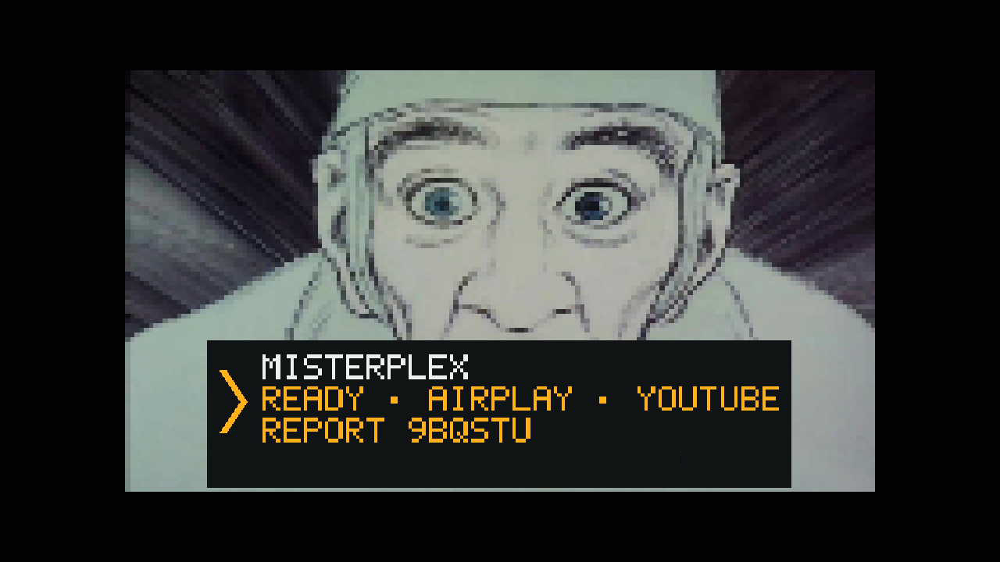](docs/screenshots/hdmi/ready-status.png) | **Ready banner with ambient art & report code** — shows `REPORT 9BQSTU` over ambient library art. Flags: `AMBIENT=1`, `REPORT_CODE=1`, `IDLE_SCREEN=logo`. |
| [](docs/screenshots/hdmi/loading-plex.png) | **Loading Plex / idle card** — `owenb_idle_card` chevron displayed on startup until `misterplexd` paints Ready. Flags: `MPX_IDLE_CARD`, `IDLE_SCREEN`, `UI_SAFE_MARGIN`. |
| [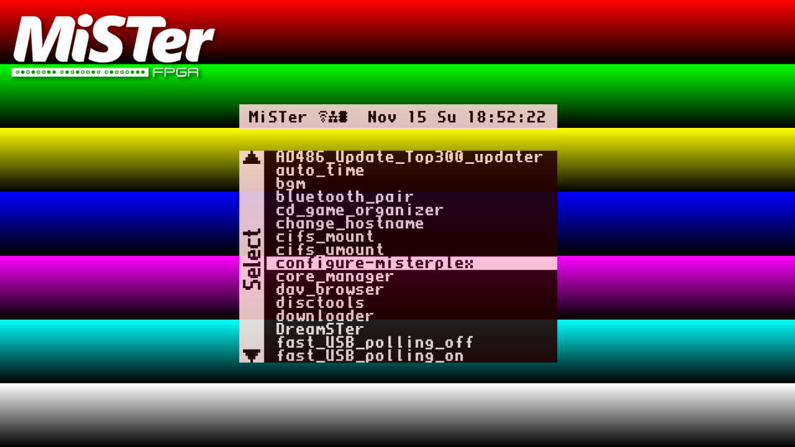](docs/screenshots/hdmi/scripts-list-configure-misterplex.png) | **MiSTer Scripts list** — unified `Scripts/configure-misterplex.sh` entry installed to `/media/fat/Scripts/`. |
| [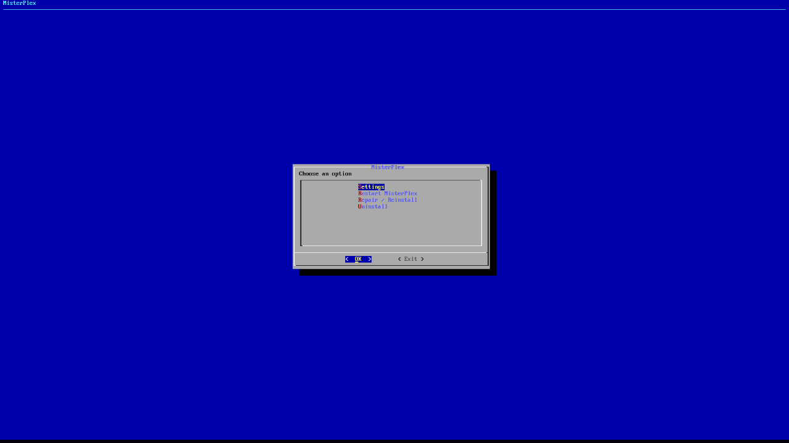](docs/screenshots/hdmi/configure-main-menu.png) | **`configure-misterplex.sh` main menu (4 items)** — **1 Settings**, **2 Restart MisterPlex**, **3 Repair / Reinstall**, **4 Uninstall**. Menu items are actions (not conf keys); uninstall maps to `configure-misterplex.sh uninstall`. |
| [](docs/screenshots/hdmi/configure-settings-dialog.png) | **`configure-misterplex.sh` Settings dialog (8 rows)** — edits `/media/fat/linux/misterplex.conf` (shown with TEST-NET placeholder `192.0.2.10:32400`). See the row-to-flag map below. |

The **1 Settings** dialog maps directly to `/media/fat/linux/misterplex.conf` keys and `configure-misterplex.sh` CLI flags:

| Settings row | conf key | CLI flag |
| --- | --- | --- |
| Plex server | `PLEX_SERVERS` | `--server` |
| plex.tv link | `PLEXTV_LINK` | `--link` |
| Analog output | `ANALOG_RASTER` | `--raster` |
| Text subtitles | `SUBTITLE_LANG` (`off`, or a language code when on) | `--subtitles` |
| Subtitle language | `SUBTITLE_LANG` | `--sub-lang` |
| Menu size | `UI_SIZE` | `--ui-size` |
| Safe margin | `UI_SAFE_MARGIN` | `--safe-margin` |
| Player name | `FRIENDLY_NAME` | `--name` |

### Plex library browser, Casting & Live TV

| Screen | Caption & related flags |
| --- | --- |
| [](docs/screenshots/hdmi/plex-browser-home.png) | **PlexUI Home** — Continue Watching, Recently Added, server/library rail, watched badges, and optional scanline look. Flags: `AMBIENT`, `CRT_LOOK` / `CRT_LOOK_PRESET`, `WATCHED_BADGES`, `HIDE_EMPTY_HUBS`, `UI_SIZE`, `UI_SAFE_MARGIN`. |
| [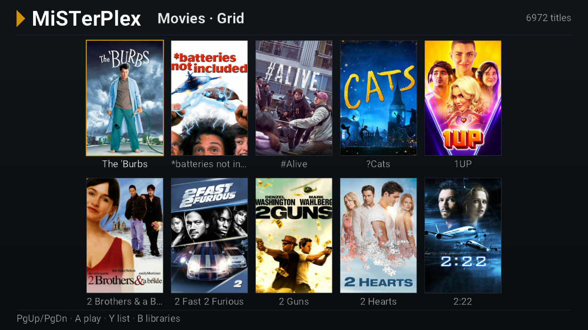](docs/screenshots/hdmi/plex-browser-library.png) | **PlexUI Library grid** — movie library poster grid. Flags: `GRID_PAGE`, `AZ_JUMP`, `FILTER_4_3`, `WATCHED_BADGES`, `UI_SIZE`, `UI_SAFE_MARGIN`. |
| [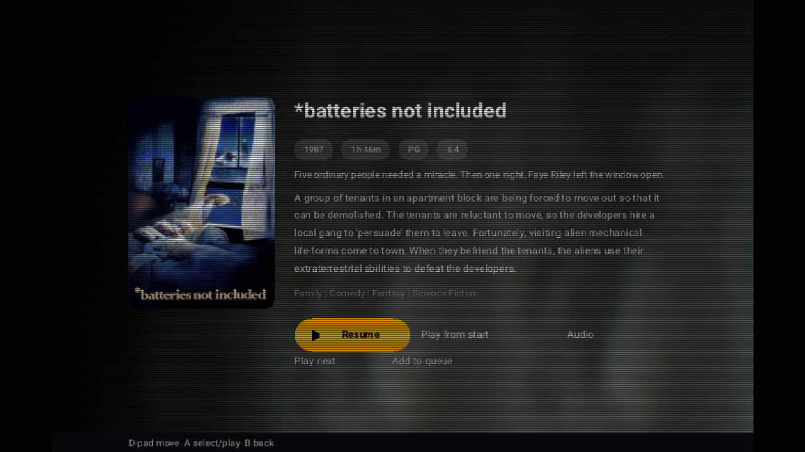](docs/screenshots/hdmi/plex-browser-title-detail.png) | **PlexUI Title detail** — synopsis, track selection, and play action. Flags: `SETSTREAMS`, `SUBTITLE_LANG`, `FORCED_SUBS`, `REMEMBER_TRACKS`, `MARK_WATCHED`, `UI_SAFE_MARGIN`. |
| [](docs/screenshots/hdmi/airplay-playback.png) | **AirPlay playback** — H.264/AAC stream pushed via the on-card AirPlay helper. Flags: `GAIRPLAY`, `GAIRPLAY_PORT`, `AIRPLAY_XCODE` / `GCAST_XCODE`, `AIRPLAY_MIRROR`, `REMEMBER_PICTURE`. |
| [](docs/screenshots/hdmi/youtube-playback.png) | **YouTube playback** — YouTube cast resolved via `yt-dlp`. Flags: `GYT`, `GYT_DIAL_PORT`, `YT_CAST_TITLE`, `YT_VOLUME`, `YT_NEXT_PREV`, `YT_CAPTIONS`, `YT_LIVE`, `YT_WARM`, `YT_HD_RETRY`, `YT_RESOLVE_TIMEOUT`. |
| [](docs/screenshots/hdmi/streaming-guide.png) | **Live TV / Spelunkr Streaming Guide** — Back When (`BW`), Vevo, and Pluto live channels (`1061`–`1078`). Flags: `SPELUNKR`, `SPELUNKR_CHANNEL`, `SPELUNKR_BACKWHEN`, `PLUTO_LIVE`, `SPELUNKR_ASPECT`, F12 OSD `Service: Live TV`. |

### Core F12 OSD, Program menus, Safe area & Picture modes

| Screen | Caption & related flags |
| --- | --- |
| [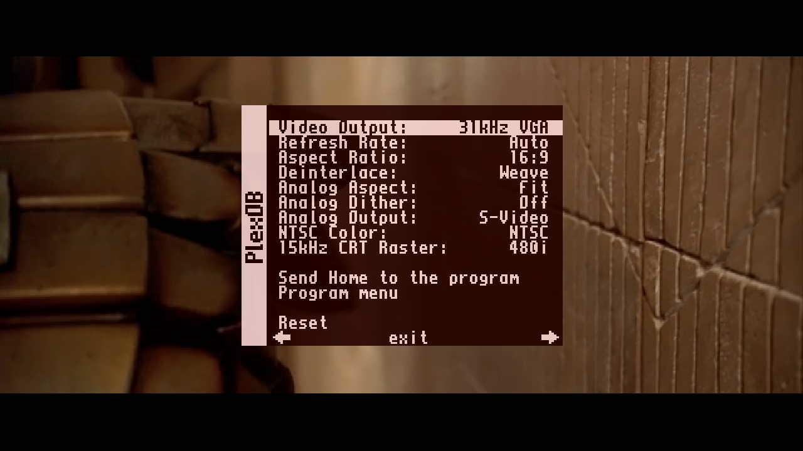](docs/screenshots/hdmi/core-settings.png) | **Core F12 OSD settings (`Plex` service)** — `Video Output`, `Refresh Rate`, `Aspect Ratio`, `Deinterlace`, `Analog Aspect`, `Analog Dither`, `Analog Output`, `NTSC Color`, `15kHz CRT Raster`, `Send Home`, `Program menu`, `Reset`. Flags: `OSD_CONTROL`, `ANALOG_RASTER`, `DEINTERLACE`. |
| [](docs/screenshots/hdmi/osd-livetv-core.png) | **Core F12 OSD (`Service: Live TV`)** — switches between Plex and Live TV / Spelunkr (`SPELUNKR=1`) without touching the Scripts menu; shows `Video Output: HDMI Native`. Flags: `OSD_CONTROL`, `SPELUNKR`. |
| [](docs/screenshots/hdmi/in-play-aspect-options.png) | **In-play Core OSD** — adjusting `Video Output: 31kHz VGA` and `Analog Aspect` live during playback. Flags: `OSD_CONTROL`, `REMEMBER_PICTURE`, `ANALOG_RASTER`. |
| [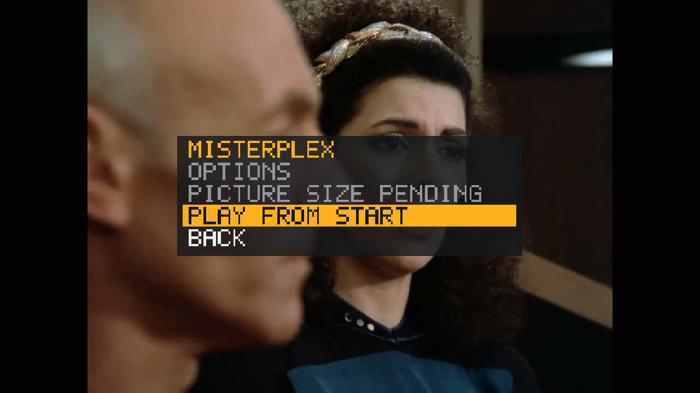](docs/screenshots/hdmi/in-play-options.png) | **In-play Program menu → Options** — `PLAY FROM START` and `PICTURE SIZE PENDING`. Flags: `IN_PLAY_OPTIONS`, `IDLE_MENU_KEY`, `MARK_WATCHED`. |
| [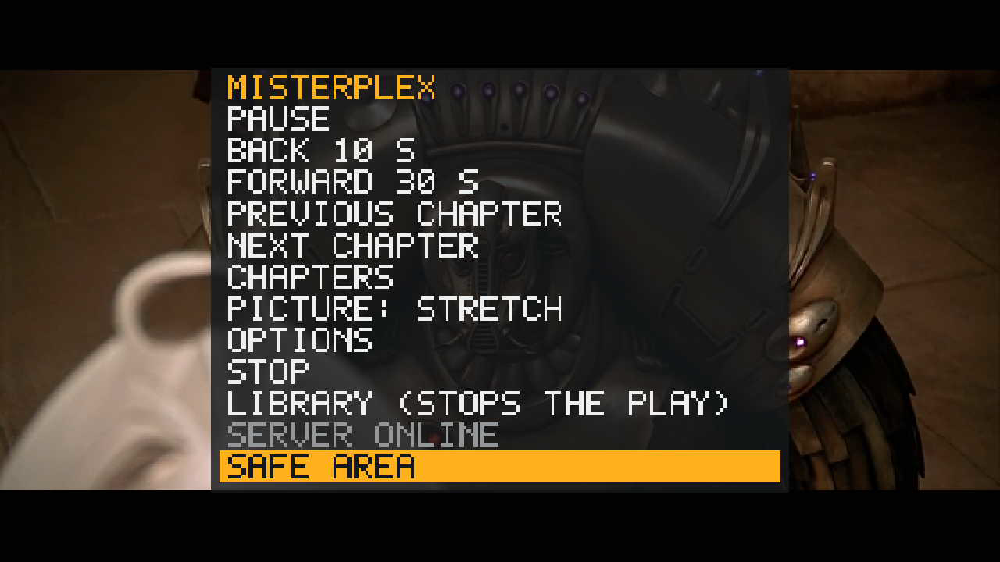](docs/screenshots/hdmi/screen-safe-area.png) | **Program menu during playback (`Safe area` / chapters / picture)** — pause, back/forward skip, chapters, picture mode, options, stop, library. Flags: `CHAPTERS`, `SKIP_BACK_MS`, `SKIP_FORWARD_MS`, `IN_PLAY_OPTIONS`, `REMEMBER_PICTURE`, `OVERSCAN_*`. |
| [](docs/screenshots/hdmi/screen-safe-area-setting.png) | **Safe area edge editor** — interactive per-edge overscan adjustment (`LEFT 11%`). Saves `OVERSCAN_LEFT`, `OVERSCAN_RIGHT`, `OVERSCAN_TOP`, `OVERSCAN_BOTTOM` to `misterplex.conf`. |
| [](docs/screenshots/hdmi/widescreen-letterbox.png) | **Widescreen: Letterbox playback** — 16:9 content letterboxed inside a 4:3 frame. Flags: `PICTURE_14_9`, `REMEMBER_PICTURE`, `SUBTITLE_POSITION=safe`. |
| [](docs/screenshots/hdmi/in-play-picture-menu.png) | **Widescreen: `PICTURE: LETTERBOX` menu** — Program menu showing `PREVIOUS/NEXT CHAPTER`, `CHAPTERS`, `PICTURE: LETTERBOX`, `OPTIONS`, `STOP`, `LIBRARY`. Flags: `CHAPTERS`, `PICTURE_14_9`, `REMEMBER_PICTURE`, `IN_PLAY_OPTIONS`. |
| [](docs/screenshots/hdmi/widescreen-14-9.png) | **Widescreen: 14:9 playback** — narrows wide picture side crop to 14:9 on 4:3 displays. Flags: `PICTURE_14_9`, `REMEMBER_PICTURE`. |
| [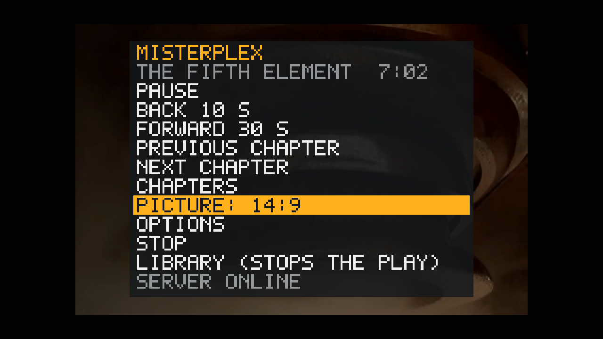](docs/screenshots/hdmi/widescreen-14-9-selected.png) | **Widescreen: `PICTURE: 14:9` selected** — Program menu with `PICTURE: 14:9` active. Flags: `PICTURE_14_9`, `REMEMBER_PICTURE`. |
| [](docs/screenshots/hdmi/widescreen-zoom.png) | **Widescreen: Zoom 4:3 playback** — fills 4:3 height by cropping sides. Flags: `REMEMBER_PICTURE`, core `Analog Aspect`. |
| [](docs/screenshots/hdmi/widescreen-zoom-selected.png) | **Widescreen: `PICTURE: ZOOM 4:3` selected** — Program menu with Zoom 4:3 active. Flags: `REMEMBER_PICTURE`. |
| [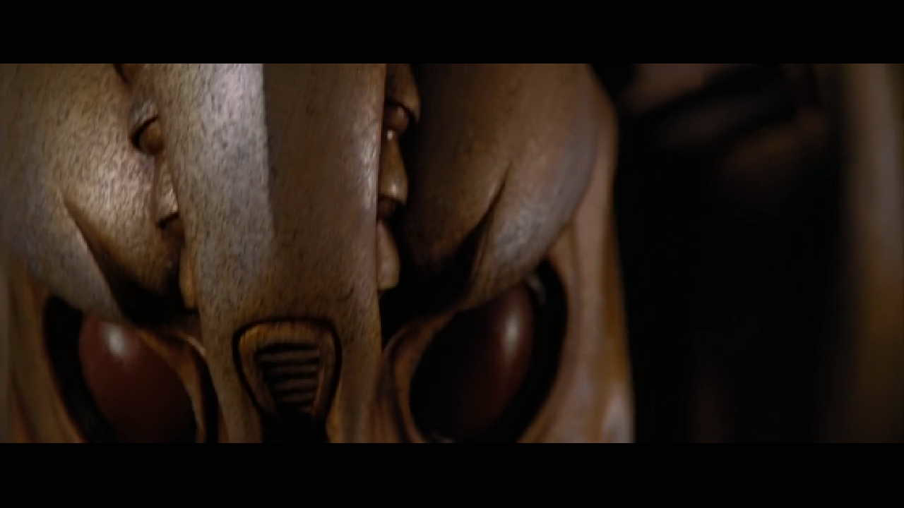](docs/screenshots/hdmi/widescreen-fit.png) | **Widescreen: Stretch / Fit playback** — full-raster stretch mode. Flags: `REMEMBER_PICTURE`, core `Analog Aspect`. |
| [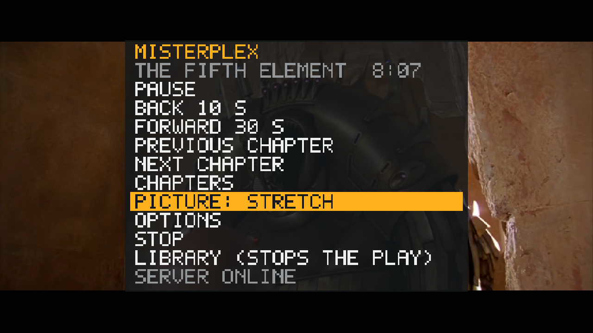](docs/screenshots/hdmi/widescreen-fit-selected.png) | **Widescreen: `PICTURE: STRETCH` selected** — Program menu with Stretch active. Flags: `REMEMBER_PICTURE`. |
| [](docs/screenshots/hdmi/four-three-native.png) | **4:3: Native playback** — 4:3 episode displayed at native 4:3 aspect. Flags: `REMEMBER_PICTURE`, `AUTO_PICTURE_MODE`, core `Aspect Ratio`. |
| [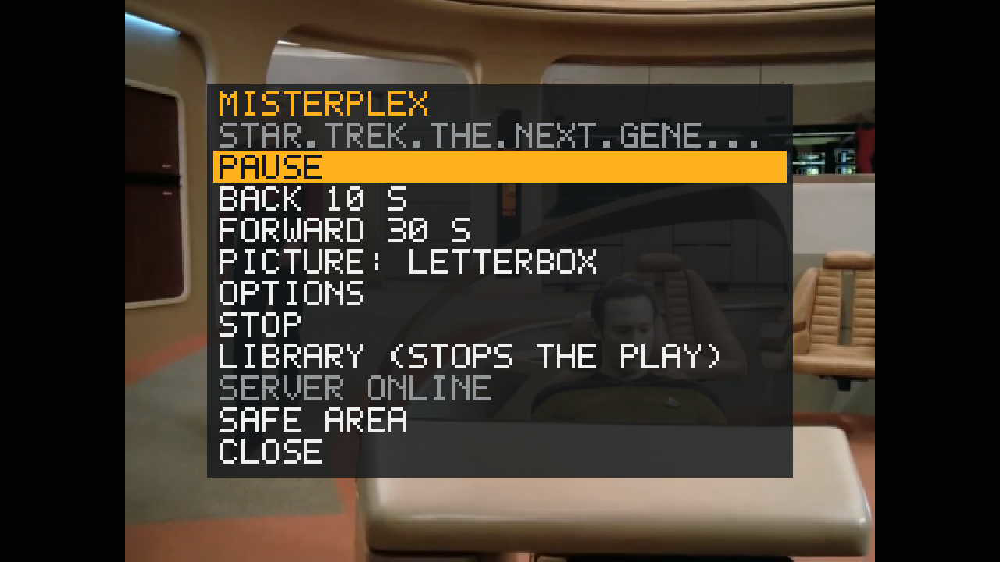](docs/screenshots/hdmi/four-three-picture-menu.png) | **4:3: `PICTURE: LETTERBOX` (native 4:3) menu** — Program menu during 4:3 playback. Flags: `REMEMBER_PICTURE`, `IN_PLAY_OPTIONS`. |
| [](docs/screenshots/hdmi/four-three-stretch.png) | **4:3: Stretch playback** — 4:3 content stretched to 16:9 width. Flags: `REMEMBER_PICTURE`, core `Aspect Ratio`. |
| [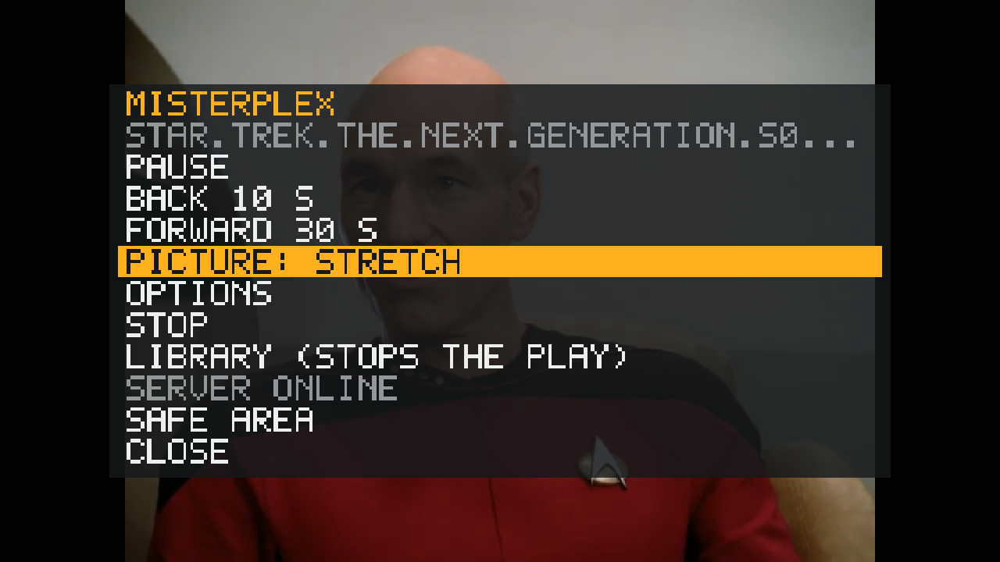](docs/screenshots/hdmi/four-three-stretch-selected.png) | **4:3: `PICTURE: STRETCH` selected** — Program menu with Stretch active on 4:3 source. Flags: `REMEMBER_PICTURE`. |

See **[docs/SCREENSHOTS.md](docs/SCREENSHOTS.md)** for the full gallery and remaining post-release capture placeholders (v2.0.0 2x browse still and analog CRT captures).

## What you need

- A MiSTer FPGA (DE10-Nano) with a current MiSTer menu, on your home network (wired is best).
- SSH access to the MiSTer (user `root`).
- A Plex Media Server and a Plex account.
- A computer with `ssh` and `scp` (or `update_all` / MiSTer Downloader).
- A TV: an analog CRT (through a MiSTer analog board or adapter) or HDMI.

## How the install works

A v2.0.0 release ships **one FPGA core**, `MiSTerPlex.rbf` (`BUILD_ID 0x0B112501`, seed 14, md5 `7f048508861967f857a5aacff79bfb6f`), which goes in `/media/fat/_Utility/MiSTerPlex.rbf` only. There is no separate `Plex.rbf` or `PlexOB.rbf`.

At boot, one line in `/media/fat/linux/user-startup.sh` (`/media/fat/misterplex/bin/misterplexd-boot-rc3.sh "$1" &`) starts `misterplexd` (under `misterplexd_supervise.sh` unless `BOOT_SUPERVISE=0`) and **never loads a core on its own**—the MiSTer stays on its menu until you load **MiSTerPlex** from `_Utility` (or launch via the Scripts menu). You never need to start the daemon yourself.

The v2.0.0 full package (`misterplex-v2.0.0.tar.gz`) includes:

| Payload item | Installed to |
| --- | --- |
| `MiSTerPlex.rbf` | `/media/fat/_Utility/MiSTerPlex.rbf` |
| `misterplexd`, `misterplexd-spelunkr`, `owenb_idle_card` | `/media/fat/misterplex/bin/` |
| `misterplexd-boot-rc3.sh`, `misterplex_mode.sh`, `misterplexd_supervise.sh`, `misterplexd_update_watch.sh`, `misterplex_cast_ready.sh`, `update_ytdlp.sh` | `/media/fat/misterplex/bin/` |
| `configure-misterplex.sh` (menu wrapper) | `/media/fat/Scripts/configure-misterplex.sh` |
| `misterplex.conf.example` | `/media/fat/misterplex/conf/misterplex.conf.example` (copied to `/media/fat/linux/misterplex.conf` when missing) |
| `MiSTerPlex.rbf.md5` | `/media/fat/misterplex/cores/MiSTerPlex.rbf.md5` |
| `Roboto-Regular.ttf`, `Roboto-Bold.ttf`, `misterplex-ad-break.jpg` | `/media/fat/misterplex/plexui/` |
| `misterplex-cacert.pem` | `/media/fat/linux/misterplex-cacert.pem` |
| `yt_warm_helper.py` | `/media/fat/misterplex/yt_warm_helper.py` |
| `airplay_xcode.py`, `run-airplay-xcode.sh`, `ffmpeg`, `ffprobe`, `MD5SUMS` | `/media/fat/linux/airplay/` (and `/media/fat/misterplex/linux/airplay/`) |
| `gcast_xcode.py`, `run-gcast-xcode.sh`, `ffmpeg`, `ffprobe`, `MD5SUMS` | `/media/fat/linux/gcast/` (and `/media/fat/misterplex/linux/gcast/`) |
| `yt-dlp_linux_armv7l.zip` (optional offline YouTube bundle) | `/media/fat/misterplex/bin/` (extracted to `/media/fat/linux/misterplex/yt-dlp/`) |

Legacy paths from older pre-releases (`/media/fat/MiSTerPlex.rbf`, old `PlexOB.rbf`, `/media/fat/Scripts/misterplex_setup.sh`, and `/media/fat/misterplex/{licenses,docs,scripts}/`) are cleaned up automatically by the installer and setup.

## Quick start (v2.0.0)

### Option A: Release tarball (`install-misterplex.sh`)

1. Download `misterplex-v2.0.0.tar.gz` and `SHA256SUMS` (or `MD5SUMS`) from https://github.com/flynnsbit/misterplex-cast/releases, verify the checksum, and unpack it:

   ```sh
   tar xzf misterplex-v2.0.0.tar.gz
   ```

2. Copy the folder to `/tmp` on the MiSTer and run `install-misterplex.sh`:

   ```sh
   scp -r misterplex-v2.0.0 root@<mister-ip>:/tmp/
   ssh root@<mister-ip> 'cd /tmp/misterplex-v2.0.0 && sh install-misterplex.sh'
   ```

   `install-misterplex.sh` verifies `SHA256SUMS`, saves `<path>.bak.<stamp>` backups of replaced files (keeping old cores in `/media/fat/misterplex/backup/`), records `.misterplex-created` / `.misterplex-files` manifests for clean uninstall, adds the boot line to `/media/fat/linux/user-startup.sh` once, and preserves any existing `/media/fat/linux/misterplex.conf` (seeding it from `conf/misterplex.conf.example` when missing). Pass `--dry-run` to preview changes without modifying the SD card, or `--reboot` to reboot on completion.

3. Reboot (`ssh root@<mister-ip> reboot`), load **MiSTerPlex** from `_Utility`, and link your account at `https://plex.tv/link` using the code shown on the Ready screen ([install guide, section 3](docs/INSTALL.md#3-first-start-and-link-to-plex-required)).

### Option B: `update_all` / MiSTer Downloader

Add `[flynnsbit/misterplex]` to your `/media/fat/downloader.ini` (see [docs/INSTALL.md](docs/INSTALL.md#option-b-update_all--mister-downloader)), run `update_all` / Downloader, then run **Scripts > configure-misterplex** on the MiSTer once so first-run setup installs the boot line, CA bundle, AirPlay/gcast helpers, and default `misterplex.conf` (when missing).

### Cold-Boot Guide

By design, **`MPX_CORE_MANUAL_ONLY=1`** is set by the boot hook (`misterplexd-boot-rc3.sh`): on a cold boot or reboot, **`misterplexd` starts in the background** (under `misterplexd_supervise.sh`) and **leaves the MiSTer on the MiSTer main menu** without hijacking the FPGA core.

How to launch and use MiSTerPlex after a cold boot:

- **MiSTer main menu / Cores:** Open **`_Utility` → `MiSTerPlex`** (loads `/media/fat/_Utility/MiSTerPlex.rbf`) to bring up the Ready screen (Plex mode) or Streaming Guide (Live TV / Spelunkr mode).
- **`Scripts/configure-misterplex`:** From the MiSTer main menu, open **Scripts → `configure-misterplex`** to edit `/media/fat/linux/misterplex.conf`, restart `misterplexd` (keeping `MPX_CORE_MANUAL_ONLY=1`), repair/reinstall, or uninstall.
- **Plex Companion / Plex Web / mobile app:** Once `MiSTerPlex` is loaded (cast-target advertisement is gated on the active core), press the Cast icon in Plex and pick your MiSTer.
- **AirPlay:** Once `MiSTerPlex` is loaded and the on-card helper (`127.0.0.1:18781`) passes `/probe`, cast from an iPhone, iPad, or Mac to your MiSTer on port `7000`.
- **Zaparoo:** With `ZAPAROO=1` (on in the shipped conf), tap an NFC card or trigger `GET/POST http://<mister-ip>:3005/misterplex/zaparoo?text=<card>` to launch a Plex title.
- **Live TV / Spelunkr cold-open behavior:** On a cold daemon start / first core open in Live TV (`Spelunkr`) mode, MiSTerPlex **lands on the Streaming Guide by design** (even when `SPELUNKR_LAST_CHANNEL` is saved) so you can pick a channel cleanly. Subsequent **in-session core reopens** (returning to `MiSTerPlex` while the daemon is still running) resume the current or saved last channel.

### Uninstalling

Run **Scripts > configure-misterplex > 4 Uninstall**, or over SSH:

```sh
ssh root@<mister-ip> 'bash /media/fat/Scripts/configure-misterplex.sh uninstall --yes'
```

Add `--dry-run`, `--keep-core`, or `--purge` (also removes `misterplex.conf`, identity, and backups). See [docs/INSTALL.md](docs/INSTALL.md#6-uninstalling-and-rolling-back).

## Configuration and flag reference

All settings live in **`/media/fat/linux/misterplex.conf`**. No installer replaces an existing settings file. To configure interactively on the TV or over SSH, run **Scripts > configure-misterplex** (`/media/fat/Scripts/configure-misterplex.sh`).

### `Scripts/configure-misterplex.sh` wrapper subcommands

When installed on the MiSTer at `/media/fat/Scripts/configure-misterplex.sh` (built from `scripts/configure-misterplex.sh`, `mister-db/misterplex_setup.sh`, and `scripts/uninstall-misterplex.sh`):

| Invocation | Behavior |
| --- | --- |
| `(no arguments)` | Opens the 4-item blue `dialog` menu (plain-text fallback on non-`dialog` terminals): **1 Settings**, **2 Restart MisterPlex**, **3 Repair / Reinstall**, **4 Uninstall**. First run automatically invokes setup if the boot line, CA bundle, or AirPlay helper is missing. (Plex ↔ Live TV switching is done only via the core **F12** OSD `Service:` option.) |
| `settings [flags...]` | Passes remaining flags directly to the settings configurator (`scripts/configure-misterplex.sh`). |
| `restart` | Restarts the currently active service mode via `/media/fat/misterplex/bin/misterplex_mode.sh` (`MPX_CORE_MANUAL_ONLY=1`). |
| `repair` \| `setup` | Runs the embedded setup (`misterplex_setup.sh`) to install/repair the boot line, CA bundle, AirPlay/gcast helpers, default `misterplex.conf` (when missing), and legacy cleanup. |
| `uninstall [flags...]` | Uninstalls MiSTerPlex. Interactive prompt asks **Uninstall** (keep settings/identity) vs **Purge** (default No). Flags: `--yes` (non-interactive), `--dry-run`, `--keep-core`, `--purge`, `--remove-program` (accepted for compatibility). |
| `--selftest` | Prints the menu tree, detected UI mode (`dialog` or `text`), `mode.sh` path, and `setup: needed\|done`, then exits. |
| `-h`, `--help` | Prints wrapper subcommands and the full settings flags/`MPX_*` reference. |

### `scripts/configure-misterplex.sh` CLI flags (14 flags)

All 14 CLI flags accepted by `scripts/configure-misterplex.sh` (and `/media/fat/Scripts/configure-misterplex.sh settings ...`):

| Flag | Values / syntax | Default | Effect |
| --- | --- | --- | --- |
| `-y`, `--non-interactive` | flag | interactive when TTY | Applies defaults/env/flags without prompting (still backs up first). |
| `--server` | `URL[,URL...]` \| `none` | empty (auto-discover) | Sets `PLEX_SERVERS` (`http://` or `https://` comma-separated, or `none` to clear). |
| `--link` | `on` \| `off` \| `1` \| `0` | `on` | Sets `PLEXTV_LINK` (`1` or `0`) for `plex.tv/link` PIN pairing. |
| `--raster` | `480i` \| `240p` \| `auto` \| `default` | `default` | Sets `ANALOG_RASTER`; `default` removes the key so core F12 controls analog output. |
| `--subtitles` | `on` \| `off` | `off` | Sets `SUBTITLE_LANG` (default `en` when `on`, or `off`). Every run forces `BURN_SUBS_FIX=0`, `AUTO_BURN=0`, and rewrites `SUBTITLES=burn` to `off`. |
| `--sub-lang` | language code (`[A-Za-z_-]+`) | `en` (when subtitles `on`) | Sets `SUBTITLE_LANG` when `--subtitles on`. |
| `--ui-size` | `normal` \| `large` | `normal` | Sets `UI_SIZE` for the on-screen Plex browser. |
| `--safe-margin` | integer `0`–`20` | `5` | Sets `UI_SAFE_MARGIN` (percent; note `misterplexd` clamps values above `15` to `0`–`15`). |
| `--name` | string (`[A-Za-z0-9 ._ -]`) | blank (auto `misterplex-<last3>`) | Sets `FRIENDLY_NAME` shown to Plex, YouTube, and AirPlay senders. |
| `--conf` | file path | `/media/fat/linux/misterplex.conf` | Target configuration file to read/update. |
| `--example` | file path | auto-located | Path to `misterplex.conf.example` used for `--fresh` or a new file. |
| `--fresh` | flag | off | Rebuilds `misterplex.conf` from `misterplex.conf.example` while preserving `FRIENDLY_NAME`, `PLAYER_ID`, `PLEXTV_TOKEN`, `PLEX_TOKEN`, `PLEX_HOME_ID`, `PLEX_HOME_TITLE`, and `PLEX_HOME_TOKEN` (keeps up to 3 `.bak.<stamp>` backups). |
| `--dry-run` | flag | off | Prints resulting keys without writing to disk. |
| `-h`, `--help` | flag | — | Prints CLI usage and the 10 user-facing `MPX_*` environment variables. |

### `MPX_*` environment variables (`scripts/configure-misterplex.sh`)

Ten user-facing `MPX_*` variables provide defaults/overrides for `scripts/configure-misterplex.sh` (CLI flags take precedence):

| Variable | Default | Meaning |
| --- | --- | --- |
| `MPX_PLEX_SERVER` | empty | Pre-fills `--server` (`PLEX_SERVERS`). |
| `MPX_PLEXTV_LINK` | `on` | Pre-fills `--link` (`on`/`off`/`1`/`0`). |
| `MPX_ANALOG_RASTER` | `default` | Pre-fills `--raster` (`480i`/`240p`/`auto`/`default`). |
| `MPX_SUBTITLES` | `off` | Pre-fills `--subtitles` (`on`/`off`). |
| `MPX_SUBTITLE_LANG` | `en` | Pre-fills `--sub-lang` (`SUBTITLE_LANG` when subtitles are `on`). |
| `MPX_UI_SIZE` | `normal` | Pre-fills `--ui-size` (`normal`/`large`). |
| `MPX_UI_SAFE_MARGIN` | `5` | Pre-fills `--safe-margin` (`0`–`20`; clamped `0`–`15` by `misterplexd`). |
| `MPX_FRIENDLY_NAME` | empty | Pre-fills `--name` (`FRIENDLY_NAME`). |
| `MPX_CONF` | `/media/fat/linux/misterplex.conf` | Overrides target config file (`--conf`). |
| `MPX_CONF_EXAMPLE` | auto-located | Overrides example template path (`--example`). |

Four internal/menu-integration variables also exist in `scripts/configure-misterplex.sh`: `MPX_KEEP_BAK` (default `3`, backup rotation count), `MPX_MENU_UI` (`dialog` or `text`), `MPX_SETTINGS_ASK` (`0` default; `1` forces interactive prompts), and `MPX_SETTINGS_CANCEL_RC` (`0` default; set to `75` by the Scripts wrapper on Cancel). The combined `/media/fat/Scripts/configure-misterplex.sh` wrapper additionally uses `MPX_MODE_SH`, `MPX_CORE_MANUAL_ONLY`, `MPX_CA_BUNDLE`, `MPX_YT_CACHE_DIR`, `MPX_YTDLP_ONLINE`, and menu test overrides (`MPX_MENU_CHOICE`, `MPX_MENU_LOG`, `MPX_MENU_YES`, `MPX_MENU_FBCON`, `MPX_MENU_NO_FIRSTRUN`, `MPX_MENU_INTERACTIVE`, `MPX_UI_TTY`).

### `misterplexd` daemon CLI flags

For reference, the ARM daemon binary (`/media/fat/misterplex/bin/misterplexd`) accepts `--version` and `-V` (handled before other arguments; they print `misterplexd <git-commit>` and exit) plus 14 CLI options parsed by the argument loop: `--name`, `--id`, `--port`, `--ffmpeg`, `--pms`, `--conf`, `--decode`, `--transcode-profile`, `--play-file`, `--play-seconds`, `--play-count`, `--play-duration-ms`, `--play-start-ms`, and `--help`.

### Core F12 OSD menu (`MiSTerPlex.rbf`)

Press **F12** while `MiSTerPlex.rbf` is loaded (settings persist in `/media/fat/config/PlexOB_v1.CFG` via Main_MiSTer when you choose Save Settings):

| OSD row | Options | Notes |
| --- | --- | --- |
| `Video Output` | `Auto`, `15kHz CRT`, `31kHz VGA`, `HDMI Native` | `HDMI Native` uses 2x browse (`1280x720` or `960x480`); `31kHz VGA` (`480p` / `640x480`) uses 2x browse; `15kHz CRT` (`480i` / `240p`) keeps 1x browse. |
| `Service` | `Plex`, `Live TV` | Switches cleanly between `misterplexd` (Plex) and `misterplexd-spelunkr` (Live TV / Pluto / Vevo / Back When). |
| `Refresh Rate` | `Auto`, `59.94 Hz`, `60 Hz`, `50 Hz` | Core output frame rate. |
| `Aspect Ratio` | `Auto`, `4:3`, `16:9` | Display aspect presented to the scaler. |
| `Deinterlace` | `Weave`, `Bob`, `Blend` | Analog/core deinterlacer (hidden when 240p is active). |
| `Anti-Twitter` | `Auto`, `Off`, `On` | Vertical flicker filter on 480i. |
| `Analog Aspect` | `Auto`, `Fit`, `Letterbox`, `Crop` | Analog output framing (`Fit` = anamorphic 16:9 fit). |
| `Analog Dither` | `Off`, `On` | DAC dithering (forced off when S-Video/Composite Y/C is selected). |
| `Analog Output` | `RGB`, `S-Video`, `Composite` | Keep aligned with `vga_mode` in `MiSTer.ini`. |
| `NTSC Color` | `NTSC`, `PAL60`, `PAL-M` | Composite/S-Video chroma encoder standard. |
| `15kHz CRT Raster` | `480i`, `240p` | Selects 15 kHz interlaced vs progressive raster. |
| `HDMI Deinterlace` | `Weave`, `Bob` | Hidden when 240p is active; kept below actions so cursor index never shifts. |
| Actions | `Send Home to the program`, `Program menu`, `Reset` | Return to Plex/Live TV home, open the on-screen Program menu, or reset the core. |

## Complete `misterplex.conf` and environment flag reference

`misterplex.conf` lives at `/media/fat/linux/misterplex.conf`. When a setting has an `MPX_<KEY>` environment override, the environment variable wins over the conf file. Restart MiSTerPlex (**Scripts > configure-misterplex > 2 Restart MisterPlex**) after editing.

> **Shipped conf vs code default:** On a fresh install (or upgrade without an existing `misterplex.conf`), `assets/misterplex.conf.example` is copied to `/media/fat/linux/misterplex.conf`, enabling the Tip A switches, `PLUTO_LIVE=1`, and `AIRPLAY_MIRROR=1` while leaving `CRT_LOOK` off (commented). If you delete a key from `misterplex.conf`, `misterplexd` falls back to its built-in code default (`off` for booleans unless noted).

### Connection, identity, boot & core

| Flag | Default (`code` / `shipped conf`) | Description |
| --- | --- | --- |
| `PLEX_BASE` | unset | Primary Plex Media Server URL (e.g. `http://YOUR-PLEX-SERVER:32400`). Multiple `PLEX_BASE=` lines append fallbacks; cast `playMedia address=` still wins. |
| `PLEX_SERVERS` | unset | Comma-separated list of Plex Media Server URLs. |
| `PLEX_HOST` | unset | Shorthand hostname/IP; expands to `http://<host>:32400`. |
| `PLEX_TOKEN` | unset | Static Plex authentication token (`X-Plex-Token`). |
| `PLEXTV_LINK` | `1` / `1` | Enable `plex.tv/link` PIN pairing on the Ready card (`1` = on, `0` = off). |
| `PLEXTV_TOKEN` | unset | Saved `plex.tv` account token written after PIN linking. |
| `PLEX_HOME_ID`, `PLEX_HOME_TITLE`, `PLEX_HOME_TOKEN` | unset | Active Plex Home profile selected via **Switch user** (never overwrites `PLEX_TOKEN`/`PLEXTV_TOKEN`). |
| `FRIENDLY_NAME` (`NAME`) | auto (`misterplex-<last3>`) | Player name shown in Plex, YouTube, and AirPlay receiver lists. |
| `PLAYER_ID` (`ID`, `MPX_ID`) | auto (`misterplex-<last3>`) | Stable player identifier. Set distinct IDs if running multiple MiSTers. |
| `BOOT_NET_ADDR` | unset | Optional IPv4 address on `BOOT_NET_IF` (`eth0`) to wait for during boot; unset skips the wait. |
| `BOOT_SUPERVISE` | `1` | Run `misterplexd` under `misterplexd_supervise.sh` auto-restart watchdog (`0` disables). |
| `MPX_CORE_MANUAL_ONLY` | `1` (boot hook) | Never auto-load `MiSTerPlex.rbf` at boot (`0` allows auto-load). |
| `MISTERPLEXD_BIN` | `bin/misterplexd` | Override daemon binary path launched by `misterplexd-boot-rc3.sh`. |
| `MPX_LEGACY_CORE_PREFIX` | `999800cf` (pinned) | Pinned fallback core prefix; conf overrides are ignored. |
| `TLS_VERIFY` | `1` | Verify TLS certificate chains and hostnames for Plex/YouTube/AirPlay (`0` disables with warning). |
| `TLS_TRUST_FILE` | unset | PEM file of a self-signed server cert or custom CA (checked alongside Mozilla roots). |
| `MPX_CA_BUNDLE` | `/media/fat/linux/misterplex-cacert.pem` | Override CA bundle path used by daemon and `update_ytdlp.sh`. |

### Display, raster, overscan & idle screen

| Flag | Default (`code` / `shipped conf`) | Description |
| --- | --- | --- |
| `ANALOG_RASTER` | unset (`default`) | `480i`, `240p`, `auto`, or unset (`default`, let core F12 control). |
| `UI_SIZE` | `normal` / `normal` | Browse UI text size: `normal` or `large` (Pad Y on browse toggles and persists). |
| `UI_SAFE_MARGIN` | `5` / `5` | Title-safe margin percent (`0`–`15` in `misterplexd`; `configure-misterplex.sh` accepts `0`–`20` and daemon clamps above `15`). |
| `OVERSCAN_LEFT`, `OVERSCAN_RIGHT`, `OVERSCAN_TOP`, `OVERSCAN_BOTTOM` | unset / `11`, `11`, `12`, `12` | Per-edge CRT overscan percent (`0`–`25`), edited interactively in **Program menu → Safe area**. |
| `CRT_LOOK` (`MPX_CRT_LOOK`) | `0` / commented (`off`) | Set `CRT_LOOK=1` to paint an HDMI CRT-look filter on the on-device UI canvas (off by default; does not affect video or analog raster). |
| `CRT_LOOK_PRESET` (`MPX_CRT_LOOK_PRESET`) | `scanlines` | Preset when `CRT_LOOK=1`: `scanlines`, `scanlines-soft`, `aperture`, or `slot`. |
| `PICTURE_14_9` (`MPX_PICTURE_14_9`) | `0` / `on` | Add 14:9 picture mode for wide video on 4:3 displays. |
| `REMEMBER_PICTURE` (`MPX_REMEMBER_PICTURE`) | `0` / `1` | Remember picture mode (`Letterbox`, `14:9`, `Zoom 4:3`, `Stretch`, `Fit-crop`) per show in `remember_picture.txt` across Plex, AirPlay, YouTube, and Spelunkr. |
| `AUTO_PICTURE_MODE` | `0` | Automatically pick a picture mode from source/display aspect. |
| `IDLE_SCREEN` | `logo` | Idle output when nothing is playing: `logo`, `black`, `screensaver` (drifting chevron), or `lastframe`. |
| `MPX_GATE_ERROR_SCREEN` | `on` | Paint `"Can't play here: ..."` error card when hardware decode and helpers fail (`off` = log only). |
| `PAUSE_DIM` (`MPX_PAUSE_DIM`) | `0` / `1` | Dim painted OSD/UI RGB to ~40% while paused or after `PAUSE_DIM_IDLE_MIN` minutes on a still UI. |
| `PAUSE_DIM_IDLE_MIN` (`MPX_PAUSE_DIM_IDLE_MIN`) | `5` | Idle minutes before `PAUSE_DIM` dims a still browse/menu screen. |

### Browsing (`PlexUI`), playback & A/V pacing

| Flag | Default (`code` / `shipped conf`) | Description |
| --- | --- | --- |
| `AMBIENT` (`MPX_AMBIENT`) | `0` / `1` | Show library backdrop artwork behind the idle Ready screen. |
| `WATCHED_BADGES` (`MPX_WATCHED_BADGES`) | `0` / `1` | Show check marks on watched posters in Home, libraries, and details. |
| `HIDE_EMPTY_HUBS` (`MPX_HIDE_EMPTY_HUBS`) | `1` | Drop empty Home hub rows while browsing (`0` keeps empty hubs). |
| `FILTER_4_3` (`MPX_FILTER_4_3`) | `0` / `1` | Add 4:3 filter chip on library grids to hide widescreen titles. |
| `GRID_PAGE` (`MPX_GRID_PAGE`) | `0` / commented (`off`) | Paginate library grids past the first 200 titles (`X-Plex-Container-Start`). |
| `AZ_JUMP` (`MPX_AZ_JUMP`) | `0` / commented (`off`) | Enable A–Z letter bar above library grids (`UP` from category chips). |
| `MARK_WATCHED` (`MPX_MARK_WATCHED`) | `0` / commented (`off`) | Add Mark watched / Mark unwatched / Remove from Continue Watching rows. |
| `THEME_MUSIC` (`MPX_THEME_MUSIC`) | `0` / commented (`off`) | Play a short ambient pad on the PlexUI Home screen while idle. |
| `CHAPTERS` (`MPX_CHAPTERS`) | `0` / `1` | Show Previous chapter, Next chapter, and chapter list in the Program menu. |
| `MARKERS` (`MPX_MARKERS`) | `0` / commented (`off`) | Enable PMS Skip Intro, Skip Credits, and Up Next overlay prompts. |
| `SCRUB_THUMBS` (`MPX_SCRUB_THUMBS`) | `0` / `1` | Show Plex BIF preview thumbnails while seeking. |
| `IN_PLAY_OPTIONS` (`MPX_IN_PLAY_OPTIONS`) | `0` / `1` | Show **Options** and **Play from start** in the in-play Program menu. |
| `IDLE_MENU_KEY` (`MPX_IDLE_MENU_KEY`) | `0` / `1` | Map USB keyboard `P` on the Ready screen to the Program menu (Safe area). |
| `ALLOW_480P60` (`MPX_ALLOW_480P60`) | `0` / `1` | Direct-play 480p (≤854×480) up to 60 fps instead of capping at 30 fps. |
| `REMOTE_H264_TRANSCODE` (`MPX_REMOTE_H264_TRANSCODE`) | `1` / `1` | Request decoder-compatible H.264 transcodes from remote Plex servers. |
| `AUTO_NEXT` | `1` / `1` | Automatically advance to the next Plex playQueue item on EOF (`0` stops). |
| `HTTP_RANGE_RESUME` (`MPX_HTTP_RANGE_RESUME`) | `1` | Reopen short PMS Part drops using `Range: bytes=<offset>-`. |
| `NET_RESUME` | `0` | Show `RECONNECTING` banner and retry demux read stalls/EOF (`1` enables). |
| `SKIP_MS`, `SKIP_FORWARD_MS`, `SKIP_BACK_MS` | `30000` / `30000` / `10000` | Seek step sizes in milliseconds for Right/Left skip (`SKIP_MS` sets both). |
| `OSD_CONTROL` | `1` / `1` | Poll core F12 `status` live for A/V offset, resync, service, and resolution (`0` disables on pre-v3 cores). |
| `AV_OFFSET_MS`, `AUDIO_DELAY_MS` | `0` / `0` | Constant pacing-loop A/V trim (`AV_OFFSET_MS`) or FFmpeg `adelay` (`AUDIO_DELAY_MS`) in ms. |
| `AUDIO_CLOCK_PPM` | `-638` / `-638` | Fallback starting ppm for the `/dev/MrAudio` feed-rate servo. |
| `AV_PRESENT_LEAD_MS`, `AV_RESYNC_DROP_MS`, `AV_CONTENT_FPS` | `40` / `80` / `auto` | Frame-present lead window, late-frame resync drop threshold (`0` = never drop), and FPS override. |
| `MATCH_SOURCE_HZ`, `SOURCE_FPS` | `off` / `auto` | Log PMS source FPS hints (`12/24/30/60`); `SOURCE_FPS=auto` uses PMS metadata. |
| `DEINTERLACE` (`MPX_DEINTERLACE`) | `yadif` (on 480i) | Software deinterlacer (`yadif`, `bwdif`, `bob`, `off`) when active. |

### Subtitles & audio tracks

| Flag | Default (`code` / `shipped conf`) | Description |
| --- | --- | --- |
| `SETSTREAMS` (`MPX_SETSTREAMS`) | `0` / `1` | List **Subtitles** and **Audio** track pickers in the in-play Program menu. |
| `SOFT_SUBS` (`MPX_SOFT_SUBS`) | `0` / `1` | Render embedded text tracks (`mov_text`, `WebVTT`, `SRT`/`ASS`) and external WebVTT on the overlay band. |
| `SUBTITLE_LANG` | `off` / `off` | Auto-selected subtitle language (`off` or ISO/language name such as `en`, `de`, `fr`). |
| `SUBTITLE_FORCED` | `0` | Filter `SUBTITLE_LANG` matching to `forced=1` tracks only. |
| `FORCED_SUBS` (`MPX_FORCED_SUBS`) | `0` / `1` | Auto-pick a `forced=1` subtitle track on default play when no track was manually chosen. |
| `SUBTITLE_POSITION` | `safe` / `safe` | `safe` places soft subs in the bottom letterbox bar on 4:3; `picture` draws over the picture. |
| `REMEMBER_TRACKS` (`MPX_REMEMBER_TRACKS`) | `0` / `1` | Save subtitle and audio track choices per show in `remember_tracks.txt`. |
| `track_pref_server_sync` | `0` / `0` | Also `PUT /library/parts/{id}` on the Plex server when picking tracks (`1` writes to PMS; own server only). |
| `controller_track_shortcuts` | `0` | Optional pad shortcut chord `"<modifier>,<audio>,<subtitle>"` to cycle tracks in play. |
| `OPENSUBTITLES_API_KEY`, `OPENSUBS_FALLBACK`, `OPENSUBTITLES_USERNAME`, `OPENSUBTITLES_PASSWORD` | unset / `1` / unset | On-device OpenSubtitles.com fallback when a title lacks a text subtitle track (`OPENSUBS_FALLBACK=0` disables). |
| `SUBTITLES`, `SUBTITLE_STREAM`, `BURN_SUBS_FIX`, `AUTO_BURN` | `off` / `0` / `0` / `0` | Server burn-in opt-in (`SUBTITLES=burn`, `AUTO_BURN=1`, or legacy `BURN_SUBS_FIX=1`); kept off by `configure-misterplex.sh`. |

### YouTube, AirPlay, Google Cast & Live TV (`Spelunkr`)

| Flag | Default (`code` / `shipped conf`) | Description |
| --- | --- | --- |
| `YT_NEXT_PREV` (`MPX_YT_NEXT_PREV`) | `0` / `1` | Honor YouTube Lounge next/previous skip commands within the cast queue. |
| `YT_VOLUME` (`MPX_YT_VOLUME`) | `0` / `1` | Honor YouTube Lounge `setVolume` / `getVolume` (0–100). |
| `YT_CAST_TITLE` (`MPX_YT_CAST_TITLE`) | `0` / `1` | Show resolved YouTube video title on the OSD play bar and phone status. |
| `YT_CAPTIONS` (`MPX_YT_CAPTIONS`) | `0` / commented (`off`) | Fetch and paint YouTube captions via `yt-dlp` on the overlay band. |
| `YT_LIVE` (`MPX_YT_LIVE`) | `0` / commented (`off`) | Copy-remux YouTube livestreams and active premieres with helper `ffmpeg`. |
| `YT_WARM`, `YT_WARM_SOCK`, `YT_WARM_SCRIPT` | `0` (commented; `1` on Plex boot if enabled) | Resident stdlib Python resolver (`yt_warm_helper.py`, 96 MiB RSS cap, Plex mode only). |
| `YT_HD_RETRY`, `YT_CACHE_DIR`, `YT_RESOLVE_TIMEOUT` | `1` / `/media/fat/misterplex/yt-cache` / `90` | Retry HD formats, persistent `yt-dlp` cache dir, and resolve ladder budget (`10`–`120` s). |
| `MPX_YTDLP_BIN`, `YTDLP_SELF_UPDATE` | bundled zip / `1` | Override `yt-dlp` path or disable daily background update (`0`). |
| `GAIRPLAY_PORT`, `GYT_DIAL_PORT` | `7000` / `8008` | AirPlay receiver port and YouTube DIAL HTTP port. |
| `AIRPLAY_XCODE`, `GCAST_XCODE` | unset (on-card `127.0.0.1:18781`) | Optional external AirPlay/Cast transcode helper URL (e.g. `http://192.0.2.10:18780`); `GCAST_XCODE` is the fallback alias. |
| `AIRPLAY_MIRROR` | `0` / **`1`** | Enable AirPlay screen mirroring (SETUP type 110; **on (`1`) in shipped `misterplex.conf.example`**; set `AIRPLAY_MIRROR=0` to disable; unverified on glass). |
| `PLUTO_LIVE` (`MPX_PLUTO_LIVE`) | `0` / **`1`** | Enable live Pluto TV HLS stitcher channels in Live TV / Spelunkr mode (**on (`1`) in shipped `misterplex.conf.example`**; set `PLUTO_LIVE=0` to disable). |
| `SPELUNKR` | `0` | Start directly in Live TV / Spelunkr mode (`1`) instead of Plex (`0`); normally controlled via F12 OSD `Service:`. |
| `SPELUNKR_CHANNEL` | last played (`SPELUNKR_LAST_CHANNEL`) | Initial Live TV channel slug/number when resuming in-session; cold first core open lands on the Streaming Guide by design. |
| `SPELUNKR_BACKWHEN` | `1` (when `SPELUNKR=1`) | Load the Back When / Pluto / Vevo guide section (`0` disables). |
| `SPELUNKR_ASPECT` | `auto` | Default Live TV aspect (`auto`, `4:3`, `16:9`) when OSD Aspect is Auto. |
| `ZAPAROO` (`MPX_ZAPAROO`) | `0` / `1` | Enable `/misterplex/zaparoo?text=<card>` NFC/launcher playback route. |
| `REPORT_CODE` (`MPX_REPORT_CODE`) | `0` / `1` | Show short support code on Ready card & phone status, and write redacted bundles under `/media/fat/misterplex/reports/`. |

### LAN & browser security guards

| Flag | Default | Description |
| --- | --- | --- |
| `LAN_AUTH` (`MPX_LAN_AUTH`), `LAN_AUTH_SECRET`, `LAN_AUTH_SECRET_FILE` | `0` / auto (`/media/fat/misterplex/lan_auth.secret`) | Require `X-MPX-Auth` shared secret on `/misterplex/*` control routes and remote helper requests (`0` = off). |
| `MPX_COMPANION_NO_ORIGIN` | `lan` (env only) | Companion no-`Origin` state-change policy: `lan` (require header client ID), `reads` (refuse all no-`Origin` writes), or `legacy`. |
| `MPX_COMPANION_ORIGINS`, `MPX_COMPANION_HOSTS`, `MPX_COMPANION_ALLOW` | default LAN/Plex allowlist | Extra allowed CORS `Origin` values (`any` still blocks `null`/`file:`/`blob:`/`data:`/extension schemes). |

### Legacy `Plex.rbf` fallback-core settings (not used by `MiSTerPlex.rbf`)

`DECODE` (`1280x720`), `TRANSCODE_PROFILE` (`720p`), `WEAK_RES`, `WEAK_BITRATE`, `PRESENT` (`fpga`), `PRESENT_MEM` (`auto`), `STREAM` (`1`), `STREAM_SKIP_RGB` (`auto`), `FFMPEG` apply only to the retired fallback `Plex.rbf` core (not shipped in v2.0.0) or transitional paths.

See [CHANGELOG.md](CHANGELOG.md) for the complete v2.0.0 change list.

## Known issues

- **Static helper `ffmpeg`/`ffprobe` SDT streams require the launch wrapper.** Direct invocations of the static ARM `ffmpeg`/`ffprobe` binaries without `GCONV_PATH` abort (`rc=134`) on DVB SDT-bearing MPEG-TS / HLS streams; `run-airplay-xcode.sh` and `run-gcast-xcode.sh` configure `/tmp/mpx-gconv-stub` (`GCONV_PATH`) automatically (and `misterplexd` already does this for `PLUTO_LIVE`/`YT_LIVE`).
- **Pluto TV startup & 1066 reopen / service-switch / 960x480 glass status.** With `PLUTO_LIVE=1` (on by default in the shipped conf), v2.0.1 fixes the 55 s `PREFETCH TIMEOUT` progress-poisoning bug and Vevo ad-break → next-video A/V desync; however, an occasional slow first Pluto tune (~30 s after an OSD service switch, or longer if the OSD is left open), a rare 1066 core-reopen black pause (~10.1 s, 1/4 on glass, self-recovering), and unscored `HDMI Native 960x480` 2x browse layout remain known items.
- **Installer `_Utility` / `_Utilities` cleanup, `uninstall-misterplex.sh` path, & `UI_SAFE_MARGIN` clamp.** `install-misterplex.sh` moves any legacy `/media/fat/MiSTerPlex.rbf` into `/media/fat/misterplex/backup/` (leaving `/media/fat/_Utility/MiSTerPlex.rbf`), migrates legacy `/media/fat/_Utilities/misterplex/` cache/socket files into `/media/fat/misterplex/`, and does not install a standalone `/media/fat/misterplex/bin/uninstall-misterplex.sh` (use **Scripts > configure-misterplex > 4 Uninstall** or `configure-misterplex.sh uninstall`). Old root `PlexOB.rbf` copies from pre-v2 installs may remain visible in the MiSTer Cores menu until removed. `configure-misterplex.sh --safe-margin` accepts `0`–`20` while `misterplexd` clamps values above `15` to `0`–`15`. Running `misterplexd-boot-rc3.sh start` immediately after a fresh install without rebooting may not bring up the daemon until reboot (the installer instructs a reboot).
- **Unverified optional / hardware items.** Analog CRT & S-Video/composite hardware validation (`docs/screenshots/analog/`), CEA 1080p, `AIRPLAY_MIRROR=1` (on by default in the shipped conf), on-card AirPlay helper live video/HLS on MiSTer hardware, `YT_CAPTIONS=1`, `YT_LIVE=1`, shared-server TV browsing, and the companion/DIAL/AirPlay browser-origin CSRF/CORS guard (`MPX_COMPANION_NO_ORIGIN` / `Origin` checks) await end-to-end TV/glass testing.
- **Picture subtitles & architecture diagram.** Text subtitles (`SRT`/`ASS`) render on the overlay; picture subtitles (`PGS`/`VobSub`) require opt-in server burn-in (`BURN_SUBS_FIX=1` / `AUTO_BURN=1`). The architecture diagram has not been redrawn for the seed-14 `0x0B112501` core.
- **Host build / test notes.** `Makefile` unit and `.mutant-check` targets use `$(ROOT)/build/...` absolute paths (pass `$(pwd)/build/<target>` when invoking individual targets), and the Spelunkr auto-video RTL simulation tail requires `iverilog`.
- **Public `update_all` database pin.** `mister-db/` workflow and `db.json.zip` pin updates follow public release tagging.

## Source and license

This project is free software under the **GNU General Public License, version 3 or (at your option) any later version** (GPL-3.0-or-later), the same licence as the upstream PlexOB core by owenb321. The vendored `hps/` client library from owenb321 stays under its own MIT licence (packaging/licenses/owenb-h264ring). See [LICENSE](LICENSE), [NOTICE](NOTICE), and [SOURCE.md](SOURCE.md). `MiSTerPlex.rbf` is built from the PlexOB core; its source is in this repository (`fpga/`) and in the release source archive below. The complete corresponding source is this repository, https://github.com/flynnsbit/misterplex-cast. Source revision: 347863a406ba423a8989d19089bfa1d4bf55e04b. Licence texts stay in this repository and in the source archive; the installer does not copy them to the MiSTer. Source code and releases: https://github.com/flynnsbit/misterplex-cast (downloads: https://github.com/flynnsbit/misterplex-cast/releases).

### Source code

See [SOURCE.md](SOURCE.md) for the directory layout, licensing policy, and full build instructions for both the ARM daemon and the FPGA bitstream. Each release page carries, next to the install package, the complete corresponding source for that build:

- `misterplex-v2.0.0-source.tar.gz`: release licences, docs, `source/` tarballs (PlexOB RTL and `gcast-ffmpeg` GPL helper sources), and kernel module source.
- The repository source export for the release, buildable with `scripts/repro_arm_build.sh`.
- Upstream source archives statically linked into `misterplexd`: UxPlay at `4e95a9ec` (patches in `tools/airplay/uxplay-patches/`), FFmpeg 8.1.2, OpenSSL 3.0.15, libplist 2.6.0, and the toolchain source snapshots (Arm GNU Toolchain `13.2.Rel1` (`GCC 13.2.1` / `glibc 2.38`) for `misterplexd` and Ubuntu armhf cross toolchain (`GCC 13.3.0` / `glibc 2.39`) for helper `ffmpeg`/`ffprobe`).

Releases: https://github.com/flynnsbit/misterplex-cast/releases

## Thanks

MiSTerPlex is built on these third-party projects (no source code or license text files are installed on the MiSTer; full license texts and corresponding source ship in the source archive):

| Component | Version | Upstream Source URL | License |
| --- | --- | --- | --- |
| MiSTer FPGA (`Main_MiSTer` / `Template_MiSTer`) | MiSTer-devel | https://github.com/MiSTer-devel/Template_MiSTer | GPL-2.0-or-later / GPL-3.0 |
| MiSTer_h264_decoder (owenb321) | commit `eac10641` (2026-10-15) | https://github.com/owenb321/MiSTer_h264_decoder | GPL-3.0-or-later (core); MIT (`hps/` client) |
| UxPlay (`libairplay`) | commit `4e95a9ec` | https://github.com/FDH2/UxPlay | LGPL-2.1-or-later (`crypto.c`: GPL-3.0-or-later) |
| RPiPlay (crypto lineage via UxPlay) | via UxPlay `4e95a9ec` | https://github.com/FD-/RPiPlay | GPL-3.0-or-later |
| playfair (via UxPlay) | via UxPlay `4e95a9ec` | https://github.com/FDH2/UxPlay | GPL-3.0 |
| csrp (`lib/srp.c`, via UxPlay) | via UxPlay `4e95a9ec` | https://github.com/cocagne/csrp | MIT |
| llhttp (via UxPlay) | `9.4.2` | https://github.com/nodejs/llhttp | MIT |
| mdnsd (via UxPlay) | via UxPlay `4e95a9ec` | https://github.com/FDH2/UxPlay | LGPL-2.1-or-later |
| libplist | `2.6.0` | https://github.com/libimobiledevice/libplist/releases/download/2.6.0/libplist-2.6.0.tar.bz2 | LGPL-2.1-or-later |
| FFmpeg (daemon static `libav`) | `8.1.2` | https://ffmpeg.org/releases/ffmpeg-8.1.2.tar.xz | LGPL-2.1-or-later |
| FFmpeg (helper `ffmpeg` & `ffprobe`) | `8.1.2` | https://ffmpeg.org/releases/ffmpeg-8.1.2.tar.xz | GPL-3.0-or-later (`ffmpeg` w/ libx264); LGPL-2.1-or-later (`ffprobe`) |
| x264 (helper `ffmpeg`) | commit `0480cb05` | https://code.videolan.org/videolan/x264 | GPL-2.0-or-later |
| OpenSSL | `3.0.15` | https://github.com/openssl/openssl/releases/download/openssl-3.0.15/openssl-3.0.15.tar.gz | Apache-2.0 |
| yt-dlp (PyInstaller onedir) | `2026.08.19` | https://github.com/yt-dlp/yt-dlp/releases/tag/2026.08.19 | Unlicense |
| CPython | `3.14` (yt-dlp onedir); `3.9.6` (MiSTer OS) | https://www.python.org/ | PSF-2.0 |
| PyInstaller | bundled in yt-dlp `2026.08.19` | https://github.com/pyinstaller/pyinstaller | GPL-2.0-or-later with bootloader exception |
| Roboto (`Roboto-Regular.ttf`, `Roboto-Bold.ttf`) | `2.001047` | https://github.com/googlefonts/roboto | Apache-2.0 |
| Spleen (`8x16`) | `2.2.0` (commit `0493c34e`) | https://github.com/fcambus/spleen | BSD-2-Clause |
| stb (`stb_image`, `stb_image_resize2`, `stb_truetype`) | `2.30` / `2.18` / `1.26` | https://github.com/nothings/stb | Public domain |
| QOI (`qoi.h`) | `2021` | https://github.com/phoboslab/qoi | MIT |
| Mozilla CA bundle (via curl.se) | `2026-09-25` | https://curl.se/docs/caextract.html | MPL-2.0 |
| curl (MiSTer OS runtime) | `7.78.0` | https://curl.se/ | curl license (MIT-style) |
| GNU C Library (`glibc`) | `2.38` (Arm GNU Toolchain `13.2.Rel1`, `misterplexd`); `2.39` (Ubuntu armhf cross, helper `ffmpeg`/`ffprobe`) | https://www.gnu.org/software/libc/ | LGPL-2.1-or-later |
| GCC runtime (`libgcc`, `libstdc++`, `libatomic`) | `13.2.1` (Arm GNU Toolchain `13.2.Rel1`, `misterplexd`); `13.3.0` (Ubuntu armhf cross, helper `ffmpeg`/`ffprobe`) | https://gcc.gnu.org/ | GPL-3.0-or-later with GCC Runtime Library Exception |

## Trademarks

Plex, YouTube, AirPlay and other names belong to their owners. MiSTerPlex is not affiliated with or endorsed by Plex, Google or Apple.
