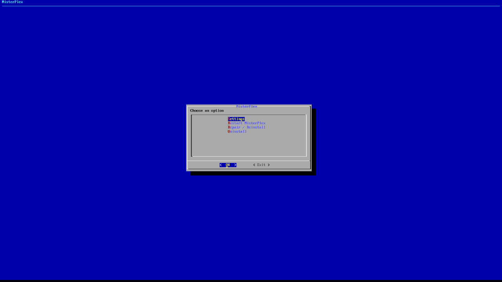
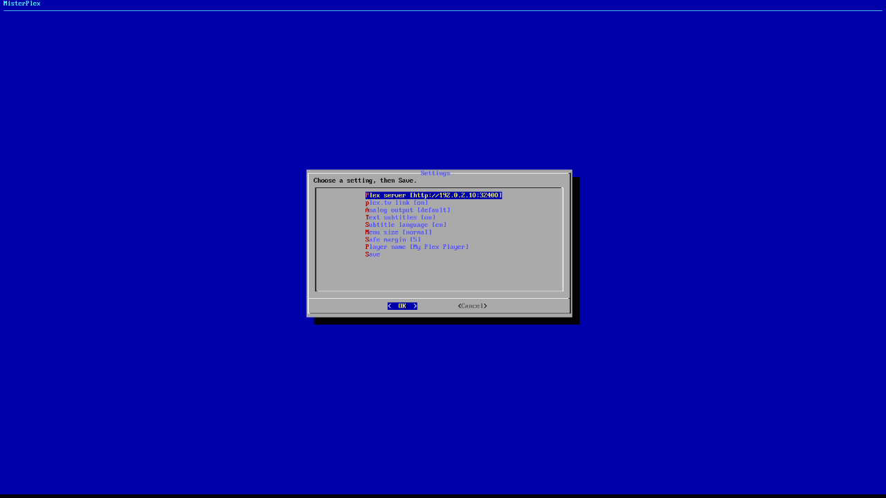

# Installing MiSTerPlex (v2.1.0)

This guide covers installing, configuring, updating, and uninstalling **MiSTerPlex v2.1.0** on a MiSTer FPGA (DE10-Nano).

Two install methods are supported:
- **Option A: Full release tarball** (`misterplex-v2.1.0.tar.gz`) using `install-misterplex.sh`.
- **Option B: `update_all` / MiSTer Downloader** (`[flynnsbit/misterplex]`), followed by running **Scripts > configure-misterplex** once on the MiSTer.

Both methods install the default **MiSTerPlex.rbf** core (`BUILD_ID 0x0B112501`, seed 14, md5 `7f048508861967f857a5aacff79bfb6f`) to `/media/fat/_Utility/MiSTerPlex.rbf` only, and leave any existing `/media/fat/linux/misterplex.conf` untouched.

## What you need

- A MiSTer FPGA on your local network (wired Ethernet recommended), with SSH enabled (user `root`) if installing from a computer.
- A Plex Media Server and a Plex account.
- A TV: HDMI or an analog CRT (RGB, component, or S-Video/composite).

---

## 1. Choose an install method

### Option A: Release tarball (`install-misterplex.sh`)

1. Download **`misterplex-v2.1.0.tar.gz`** and **`SHA256SUMS`** (or **`MD5SUMS`**) from https://github.com/flynnsbit/misterplex-cast/releases.
2. Verify and unpack the archive on your computer:

   ```sh
   sha256sum -c SHA256SUMS --ignore-missing
   tar xzf misterplex-v2.1.0.tar.gz
   ```

   *(On macOS: `shasum -a 256 -c SHA256SUMS` or check with `md5sum` against `MD5SUMS`.)*

3. Copy the unpacked folder to `/tmp` on your MiSTer and run `install-misterplex.sh`:

   ```sh
   scp -r misterplex-v2.1.0 root@<mister-ip>:/tmp/
   ssh root@<mister-ip> 'cd /tmp/misterplex-v2.1.0 && sh install-misterplex.sh'
   ```

   Pass `--dry-run` first to preview every action without touching the SD card:

   ```sh
   ssh root@<mister-ip> 'cd /tmp/misterplex-v2.1.0 && sh install-misterplex.sh --dry-run'
   ```

#### What `install-misterplex.sh` does

- **Verifies checksums first.** Checks `SHA256SUMS` (or `MD5SUMS`) before modifying anything. If a file fails verification, it stops immediately.
- **Installs one core in `_Utility` only:** copies `cores/MiSTerPlex.rbf` (`7f048508861967f857a5aacff79bfb6f`) to `/media/fat/_Utility/MiSTerPlex.rbf` and writes `/media/fat/misterplex/cores/MiSTerPlex.rbf.md5`. Accepted core pins in `install-misterplex.sh` (`RBF_PINS`) are `7f048508` (v2.0.0 seed 14, default), `042f8617` (v1.0.1), `3ed684ce` (seed 12), and `96eb13d2` (seed 10).
- **Installs daemon, helpers, UI assets, and configurator:**
  - `/media/fat/misterplex/bin/`: `misterplexd`, `misterplexd-spelunkr`, `owenb_idle_card`, `misterplexd-boot-rc3.sh`, `misterplex_mode.sh`, `misterplexd_supervise.sh`, `misterplexd_update_watch.sh`, `misterplex_cast_ready.sh`, `update_ytdlp.sh`, and (when bundled) `yt-dlp_linux_armv7l.zip`.
  - `/media/fat/Scripts/configure-misterplex.sh`: unified menu, settings configurator, restart, repair, and uninstall tool.
  - `/media/fat/misterplex/conf/misterplex.conf.example` and `/media/fat/misterplex/plexui/` (`Roboto-Regular.ttf`, `Roboto-Bold.ttf`, `misterplex-ad-break.jpg`).
  - `/media/fat/linux/misterplex-cacert.pem` (Mozilla CA bundle), `/media/fat/misterplex/yt_warm_helper.py`, `/media/fat/linux/airplay/` (`airplay_xcode.py`, `run-airplay-xcode.sh`, `ffmpeg`, `ffprobe`, `MD5SUMS`), and `/media/fat/linux/gcast/` (`gcast_xcode.py`, `run-gcast-xcode.sh`, `ffmpeg`, `ffprobe`, `MD5SUMS`).
- **Adds the boot line once:** appends `/media/fat/misterplex/bin/misterplexd-boot-rc3.sh "$1" &` to `/media/fat/linux/user-startup.sh` (saving `user-startup.sh.bak.<stamp>`). At boot, `misterplexd-boot-rc3.sh` starts `misterplexd` under `misterplexd_supervise.sh` and **never auto-loads a core**—the MiSTer boots to its Menu and waits for you to load **MiSTerPlex** from `_Utility`.
- **Cleans up legacy pre-release paths:** moves/retires any stale `/media/fat/MiSTerPlex.rbf` or `PlexOB.rbf` into `/media/fat/misterplex/backup/`, and removes legacy `/media/fat/Scripts/misterplex_setup.sh` and `/media/fat/misterplex/{licenses,docs,scripts}/` (while keeping `/media/fat/linux/gcast/` and `/media/fat/linux/airplay/` populated with the 5 shipped helper files each).
- **Backs up replaced files without touching your settings:** replaced files are saved as `<path>.bak.<stamp>` (and older cores in `/media/fat/misterplex/backup/`), while `/media/fat/linux/misterplex.conf` is created from `conf/misterplex.conf.example` (`PLUTO_LIVE=1`, `AIRPLAY_MIRROR=1`, `CRT_LOOK` off) only when missing. (`backup-<time>/restore.sh` was the v1.0.1 minimal-installer rollback script; in v2.0.0 use `Scripts > configure-misterplex > 4 Uninstall` or restore `.bak.<stamp>` files.)

---

### Option B: `update_all` / MiSTer Downloader

1. Add the MiSTerPlex database section to `/media/fat/downloader.ini` on your MiSTer (or drop `downloader_flynnsbit_misterplex.ini` into `/media/fat/`):

   ```ini
   [flynnsbit/misterplex]
   db_url = https://raw.githubusercontent.com/flynnsbit/misterplex-cast/main/mister-db/db.json.zip
   ```

2. Run **`update_all`** (or MiSTer **Scripts > downloader**). Downloader stages the core, binaries, CA bundle, AirPlay/gcast helpers, and `Scripts/configure-misterplex.sh` onto `/media/fat/`.
3. On the MiSTer, open **Scripts > configure-misterplex** once (or run `ssh -t root@<mister-ip> bash /media/fat/Scripts/configure-misterplex.sh`).
   - On a fresh Downloader install, `configure-misterplex.sh` detects that first-run setup is needed (missing boot line, CA bundle, or AirPlay/gcast helpers) and runs the embedded setup automatically before opening the menu.
   - After an `update_all` upgrade over an existing install, choose **3 Repair / Reinstall** (or run `bash /media/fat/Scripts/configure-misterplex.sh repair`) if you want setup to re-verify the boot line, CA bundle, AirPlay helper, and legacy cleanup, then choose **2 Restart MisterPlex** (or reboot).

---

## 2. Settings file (`/media/fat/linux/misterplex.conf`)

MiSTerPlex stores all settings in **`/media/fat/linux/misterplex.conf`**. On a new card without a conf file, MiSTerPlex runs with built-in defaults until you configure it or copy the example file.

### Guided setup on the TV or over SSH

Run **Scripts > configure-misterplex** on the MiSTer, or over SSH:

```sh
ssh -t root@<mister-ip> bash /media/fat/Scripts/configure-misterplex.sh
```

That opens the 4-item blue `dialog` menu (falling back to plain text on serial/non-`dialog` terminals):

1. **Settings** — edit Plex server, plex.tv linking, analog raster (`480i`, `240p`, `auto`, `default`), subtitles, subtitle language, UI size, safe margin, and player name.
2. **Restart MisterPlex** — restarts the active service (`Plex` or `Spelunkr` / Live TV) using `/media/fat/misterplex/bin/misterplex_mode.sh`.
3. **Repair / Reinstall** — runs the embedded setup to verify/copy `misterplex-cacert.pem`, `linux/airplay/`, `linux/gcast/`, `plexui/`, the boot line in `user-startup.sh`, and legacy cleanup.
4. **Uninstall** — offers **Uninstall** (keeps `misterplex.conf` and player identity) or **Purge** (removes settings and identity as well; default No).

| Main menu (4 items) | Settings dialog (8 options) |
| --- | --- |
| [](screenshots/hdmi/configure-main-menu.png) | [](screenshots/hdmi/configure-settings-dialog.png) |

*(To switch between Plex and Live TV / Spelunkr mode, open the core's **F12** OSD and change **Service:** — service switching is not in the Scripts menu.)*

### Non-interactive `configure-misterplex.sh` flags and subcommands

Wrapper subcommands on `/media/fat/Scripts/configure-misterplex.sh`:

- `settings [flags...]` — invoke the settings configurator directly
- `restart` — restart the active mode
- `repair` / `setup` — run embedded setup/repair
- `uninstall [--yes] [--dry-run] [--keep-core] [--purge] [--remove-program]` — uninstall MiSTerPlex
- `--selftest` — print menu tree, UI mode, `mode.sh` path, and `setup: needed|done`
- `-h`, `--help` — show full help

All 14 CLI flags of `configure-misterplex.sh` (and `configure-misterplex.sh settings ...`):

| Flag | Values | Default | Notes |
| --- | --- | --- | --- |
| `-y`, `--non-interactive` | — | interactive on TTY | Write without prompting |
| `--server` | `URL[,URL...]` \| `none` | empty (auto-discover) | Sets `PLEX_SERVERS` (`http://` or `https://`) |
| `--link` | `on` \| `off` \| `1` \| `0` | `on` | Sets `PLEXTV_LINK` |
| `--raster` | `480i` \| `240p` \| `auto` \| `default` | `default` | Sets `ANALOG_RASTER`; `default` removes key so core F12 controls output (for `240p`, save core F12 settings once first) |
| `--subtitles` | `on` \| `off` | `off` | Sets `SUBTITLE_LANG` or `off`; forces `BURN_SUBS_FIX=0` and `AUTO_BURN=0` |
| `--sub-lang` | code (`[A-Za-z_-]+`) | `en` (when on) | Sets `SUBTITLE_LANG` |
| `--ui-size` | `normal` \| `large` | `normal` | Sets `UI_SIZE` |
| `--safe-margin` | `0`–`20` | `5` | Sets `UI_SAFE_MARGIN` (clamped `0`–`15` by daemon/example conf) |
| `--name` | string (`[A-Za-z0-9 ._ -]`) | blank (`misterplex-<last3>`) | Sets `FRIENDLY_NAME` |
| `--conf` | path | `/media/fat/linux/misterplex.conf` | Target conf file |
| `--example` | path | auto-located | Example template path |
| `--fresh` | — | off | Rebuilds from example while preserving `FRIENDLY_NAME`, `PLAYER_ID`, and Plex tokens; rotates up to 3 `.bak.<stamp>` backups |
| `--dry-run` | — | off | Print keys without writing |
| `-h`, `--help` | — | — | Print usage and `MPX_*` vars |

Example non-interactive setup:

```sh
ssh root@<mister-ip> 'bash /media/fat/Scripts/configure-misterplex.sh settings -y --server http://<server-ip>:32400 --raster 240p --subtitles on --sub-lang en'
```

The 10 user-facing environment variables (`MPX_PLEX_SERVER`, `MPX_PLEXTV_LINK`, `MPX_ANALOG_RASTER`, `MPX_SUBTITLES`, `MPX_SUBTITLE_LANG`, `MPX_UI_SIZE`, `MPX_UI_SAFE_MARGIN`, `MPX_FRIENDLY_NAME`, `MPX_CONF`, `MPX_CONF_EXAMPLE`) set defaults for those flags (see `configure-misterplex.sh --help`).

### Optional: copy the example conf manually (only if missing)

Never overwrite an existing `misterplex.conf`. Guard any copy with `test -f`:

```sh
ssh root@<mister-ip> 'test -f /media/fat/linux/misterplex.conf || cp /media/fat/misterplex/conf/misterplex.conf.example /media/fat/linux/misterplex.conf'
```

Or from your unpacked release folder:

```sh
ssh root@<mister-ip> 'test -f /media/fat/linux/misterplex.conf' || scp conf/misterplex.conf.example root@<mister-ip>:/media/fat/linux/misterplex.conf
```

Restart MiSTerPlex (`Scripts > configure-misterplex > 2 Restart MisterPlex`) or reboot after editing `misterplex.conf`.

---

## 3. First start and link to Plex (required)

```sh
ssh root@<mister-ip> reboot
```

When the MiSTer finishes booting to its Menu, open **\_Utility** and load **MiSTerPlex** (remember: the boot script starts `misterplexd` in the background and never auto-loads a core). The MISTERPLEX Ready screen shows two rows, for example:

```text
Ready · AirPlay · YouTube
plex.tv/link ABCD
```

*(The first row lists only the receivers that are running, so it may show `Ready`, `Ready · AirPlay`, `Ready · YouTube`, or `Ready · AirPlay · YouTube`. `ABCD` stands for your own four-character code.)*

**Link the MiSTer to your Plex account now:**

1. On your phone or computer, open **https://plex.tv/link**.
2. Sign in to your Plex account.
3. Enter the 4-character code from the Ready screen (also saved on the MiSTer at `/media/fat/misterplex/plex_link.txt`).

The code row disappears once linked, and your sign-in token (`PLEXTV_TOKEN`) is saved in `/media/fat/linux/misterplex.conf`. Re-running `install-misterplex.sh`, `update_all`, or `configure-misterplex.sh --fresh` keeps your token.

> **Until you link, Browse Plex on the TV shows `FETCH FAILED`.** Casting from the Plex app on your phone still works without linking, because the phone sends its own sign-in. Browsing your libraries on the TV requires linking.

Other link-row messages:
- `plex.tv/link: connecting, retrying` — the MiSTer cannot reach `plex.tv` yet; wait or check network/clock.
- `Plex link error, retrying` — `plex.tv` refused the request repeatedly; restart MiSTerPlex if it persists.
- If a code expires, `misterplexd` fetches and displays a fresh code automatically.

---

## 4. Check that it works

- The `plex.tv/link` row disappears from the Ready screen and **Browse Plex** lists your libraries.
- In the Plex app on your phone, tap the cast button and confirm your MiSTer appears in the player list.
- From a computer on the same LAN:

  ```sh
  curl -s http://<mister-ip>:3005/resources
  ```

- Open `http://<mister-ip>:3005/misterplex/status` in a browser for the phone status page.
- Check the boot and service log at `/tmp/misterplexd-boot-rc3.log`.

---

## 5. Restarting and updating

- **Restart MiSTerPlex:** run **Scripts > configure-misterplex > 2 Restart MisterPlex**, or over SSH:

  ```sh
  ssh root@<mister-ip> '/media/fat/Scripts/configure-misterplex.sh restart'
  ```

  *(Or stop/start via the boot hook: `/media/fat/misterplex/bin/misterplexd-boot-rc3.sh stop && /media/fat/misterplex/bin/misterplexd-boot-rc3.sh start`. Do not use `killall`.)*

- **Update MiSTerPlex:** re-run `install-misterplex.sh` from a new tarball or run `update_all` + **Scripts > configure-misterplex**. Your `misterplex.conf` and tokens are preserved.
- **Update YouTube (`yt-dlp`) alone:**

  ```sh
  ssh root@<mister-ip> /media/fat/misterplex/bin/update_ytdlp.sh
  ```

---

## 6. Uninstalling and rolling back

### Uninstall via `configure-misterplex.sh` (recommended)

Open **Scripts > configure-misterplex > 4 Uninstall**, or run over SSH:

```sh
# Keeps misterplex.conf, player identity, and backup folders:
ssh root@<mister-ip> 'bash /media/fat/Scripts/configure-misterplex.sh uninstall --yes'

# Preview first without deleting anything:
ssh root@<mister-ip> 'bash /media/fat/Scripts/configure-misterplex.sh uninstall --dry-run'

# Keep MiSTerPlex.rbf in _Utility:
ssh root@<mister-ip> 'bash /media/fat/Scripts/configure-misterplex.sh uninstall --yes --keep-core'

# Remove everything including misterplex.conf, identity, and backups:
ssh root@<mister-ip> 'bash /media/fat/Scripts/configure-misterplex.sh uninstall --yes --purge'
```

Uninstall stops `misterplexd`, `misterplexd_supervise.sh`, and the AirPlay / gcast helper, removes the boot line from `/media/fat/linux/user-startup.sh`, removes `/media/fat/_Utility/MiSTerPlex.rbf` (unless `--keep-core`), removes program directories under `/media/fat/misterplex/`, removes `/media/fat/linux/misterplex-cacert.pem`, removes only the installer-managed files inside `/media/fat/linux/airplay/` and `/media/fat/linux/gcast/` (via `.misterplex-files` / `MD5SUMS`), and removes `/media/fat/Scripts/configure-misterplex.sh`. Without `--purge`, your `/media/fat/linux/misterplex.conf`, player identity, and `/media/fat/misterplex/backup*` folders stay intact.

The runtime package does not ship a separate on-card `uninstall-misterplex.sh`. That script lives in the source tree (`scripts/uninstall-misterplex.sh`) and is compiled into `Scripts/configure-misterplex.sh`; use the **4 Uninstall** menu item or the `uninstall` subcommand above.

### Restoring `.bak.<stamp>` backups

When upgrading over an existing install, `install-misterplex.sh` saves replaced files as `<path>.bak.<stamp>` (for example `user-startup.sh.bak.<stamp>` and `misterplex.conf.bak.<stamp>` when configured) and moves superseded cores into `/media/fat/misterplex/backup/`. To restore a previous core or startup file manually, copy the `.bak.<stamp>` file back into place and reboot.

---

## Troubleshooting

- **Installer stops with a checksum error:** the tarball download is incomplete or corrupted. Re-download and re-verify `SHA256SUMS` / `MD5SUMS`.
- **Browse Plex shows `FETCH FAILED`:** link your MiSTer at https://plex.tv/link using the code on the Ready screen (section 3). Check that `PLEXTV_LINK` is not `0` (`configure-misterplex.sh settings -y --link on`) and that your Plex server is reachable from the MiSTer.
- **MiSTer is not in the cast list:** make sure the **MiSTerPlex** core is loaded (since v2.0.0 never auto-loads a core at boot; casting only advertises while a MiSTerPlex core is loaded) and your phone is on the same LAN. Check `/tmp/misterplexd-boot-rc3.log` and `http://<mister-ip>:3005/resources`.
- **"Daemon not running" on the TV:** run **Scripts > configure-misterplex > 2 Restart MisterPlex** (or `3 Repair / Reinstall`). Check `/tmp/misterplexd-boot-rc3.log`.
- **S-Video / composite shows black-and-white or no picture:** `vga_mode` in `/media/fat/MiSTer.ini` and **Analog Output** in the core's F12 menu must agree (`yc` + `SVideo/CVBS` for S-Video/composite, or `rgb`/`ypbpr` + `RGB/YPbPr`), and `ANALOG_RASTER` in `misterplex.conf` should be `default` (or `480i`) rather than `240p` for NTSC S-Video/composite.
- **HDMI picture glitches after switching from 480i:** verify `/media/fat/_Utility/MiSTerPlex.rbf` is the v2.0.0 seed-14 core (`7f048508861967f857a5aacff79bfb6f`, `BUILD_ID 0x0B112501`), which includes the `ascal.vhd` vsync reset fix.
